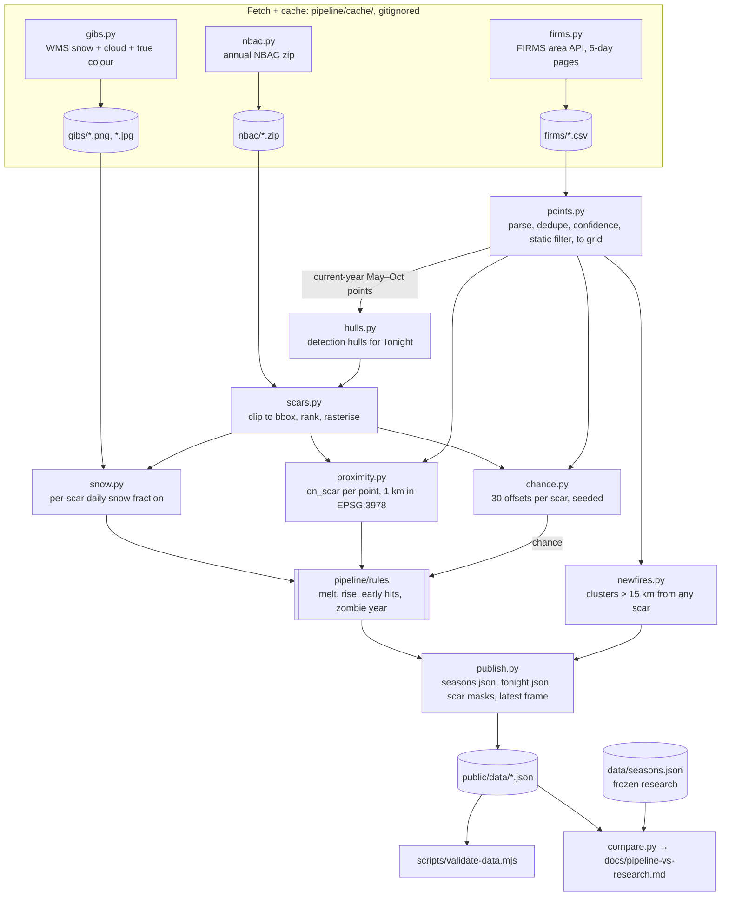

# Design Document

data-pipeline

## Overview

A Python 3.12 pipeline in `pipeline/` that fetches NASA FIRMS fire points, NASA GIBS VIIRS snow and true-colour frames,
and NBAC burned-area polygons, and publishes `public/data/seasons.json` and `public/data/tonight.json` in the schema in
#[[file:docs/method.md]]. All rule decisions (melt day, rise, early hits, zombie year) come from `pipeline/rules/`
(spec 01). The pipeline only prepares inputs for the engine (snow fractions, on-scar flags, chance offsets) and writes
its results. The UI never re-implements the rule.

Two commands:

- `uv run python -m pipeline seasons` builds the three replay seasons (Spring 2024, 2025, 2026). The inputs are archived
  science data, so it runs on demand and its output only changes when the method changes.
- `uv run python -m pipeline tonight` builds the live season. It runs nightly in GitHub Actions and commits
  `public/data/tonight.json` and `public/img/viirs-latest.webp`.

A third command, `uv run python -m pipeline compare`, writes `docs/pipeline-vs-research.md`. That report compares the
FIRMS/NBAC results with the frozen imagery-based baseline `data/seasons.json` and states every difference.

## Facts checked on 2026-11-11 (design inputs)

| Fact | Source | Effect on the design |
|---|---|---|
| FIRMS area API: `DAY_RANGE` 1–5; returns DATE…DATE+DAY_RANGE−1 | https://firms.modaps.eosdis.nasa.gov/api/area/ | Fetch in 5-day pages |
| Key limit: 5000 transactions per 10 minutes | `mapkey_status` for our key | Throttle to 1 request/s; check status before a run |
| SP (standard processing) covers S-NPP 2012-01-20…2026-07-31, NOAA-20 2018-04-01…2026-07-31, NOAA-21 2023-03-01…2026-07-31 | `/api/data_availability/` | All three replay springs (Mar 21–Jul 1) are fully in SP |
| NRT starts 2026-08-01 for NOAA-20 and S-NPP; NOAA-21 NRT from 2024-01-17. S-NPP NRT ends 2026-11-02 | same | Tonight uses NOAA-20 + NOAA-21 NRT; S-NPP only where it has data |
| SP rows carry `type` (sample 2024-05-10: 3161 × 0, 9 × 2); NRT rows have no `type` | 1-day samples for the Revenant bbox | Static filter differs for SP and NRT (see Static sources) |
| `confidence` takes `l`, `n`, `h` (sample: 753 l, 1609 n, 808 h) | same | Keep `n` and `h` (firms-points skill); report the effect |
| GIBS NDSI snow and true colour return 1060×716 frames for the bbox. On 2026-11-08 S-NPP true colour is 100% black and S-NPP snow has 0 opaque px; NOAA-20 has data | WMS GetMap probes | Tonight frames and snow use NOAA-20 |
| NBAC annual polygons exist for 2023 (181 MB), 2024 (71 MB) and 2025 (96 MB), release 20260513 | https://cwfis.cfs.nrcan.gc.ca/downloads/nbac/ | Replay scars come from NBAC; Tonight (2026 scars) falls back to detection hulls |
| Existing `public/img/scars-YYYY.png`: 1060×716 RGBA, white with alpha = footprint | `public/img/README.md` | Regenerate in the same format from the new scars |
| GIBS WMS lists no VIIRS cloud-mask layer. Its VIIRS cloud layers are cloud properties (`Cloud_Top_Height_Day/Night`, `Cloud_Optical_Thickness`, `Cloud_Effective_Radius`) for S-NPP and NOAA-20 | WMS GetCapabilities | Use `Cloud_Top_Height_Day` opacity as the cloud mask |
| On 2024-04-10, 2024-05-02 and 2025-04-20, `VIIRS_SNPP_Cloud_Top_Height_Day` was opaque on 98–99 % of "bright non-snow" true-colour pixels (the gibs-imagery skill's cloud proxy); `Cloud_Optical_Thickness` covered only 79–87 % | Probe of all three layers for the bbox | Cloud Top Height is the more complete mask; snow pixels win where both are opaque |

## Architecture



## Components and Interfaces

### Module layout

```
pipeline/__main__.py      # CLI: seasons | tonight | compare  (argparse; exit 1 on any validation failure)
pipeline/config.py        # bbox, grid, season dates, sources, thresholds; key loading (env, then .env)
pipeline/grid.py          # lon/lat <-> grid x/y (docs/method.md formulas); EPSG:3978 transformer
pipeline/http.py          # one requests.Session; throttle 1 req/s; retries; key redaction in every message
pipeline/firms.py         # area API pages -> cached CSV text; mapkey_status budget check
pipeline/gibs.py          # WMS GetMap -> cached frame bytes
pipeline/nbac.py          # download + cache NBAC_<year>_<release>.zip; read polygons with pyshp
pipeline/points.py        # CSV -> Point records; dedupe; confidence; static filter; bbox clip
pipeline/scars.py         # Scar records: polygon (EPSG:3978), grid mask, size_px, centroid
pipeline/hulls.py         # detection hulls from points (research method) for years without NBAC
pipeline/snow.py          # per-scar snow fraction per day from NDSI frames; region-wide missing rule
pipeline/proximity.py     # on_scar flag: point within 1 km of a scar polygon
pipeline/chance.py        # offset simulation -> chance hit rate
pipeline/newfires.py      # spring points > 15 px from any scar -> clusters -> first day
pipeline/keyframe.py      # cloud score; pick latest low-cloud true-colour frame
pipeline/build.py         # build_season(year) and build_tonight(today) -> plain dicts in the published schema
pipeline/publish.py       # atomic JSON + PNG/WebP writes into public/
pipeline/compare.py       # report vs data/seasons.json
scripts/validate-data.mjs # Node, no dependencies: schema + invariants for public/data/*.json
.github/workflows/nightly.yml
```

`pipeline/rules/` stays pure (spec 01). All I/O lives in `http.py`, `firms.py`, `gibs.py`, `nbac.py`, `publish.py` and
`compare.py`. Every other module is a pure function over in-memory data, so it can be tested without a network.

### Key functions

```python
# config.py
def firms_key() -> str               # os.environ["FIRMS_MAP_KEY"], else FIRMS_MAP_KEY= line in repo-root .env; raises KeyMissing

# firms.py
def fetch_range(source: str, start: date, days: int) -> str          # cached; days 1..5
def fetch_period(source: str, first: date, last: date) -> list[str]  # 5-day pages covering [first, last]
def budget() -> tuple[int, int]                                      # (used, limit) from mapkey_status

# gibs.py
def frame(layer: str, day: date, fmt: Literal["png", "jpeg"]) -> bytes | None   # None on HTTP error or empty frame

# points.py
def parse(csv_text: str, source: str) -> list[Point]
def clean(points: Iterable[Point], static_cells: set[tuple[int, int]]) -> list[Point]

# scars.py
def nbac_scars(year: int) -> list[Scar]             # all scars in bbox, sorted by area, largest first
def top_graves(scars: list[Scar], n: int = 24) -> list[Scar]

# snow.py
def snow_series(scar: Scar, frames: Sequence[np.ndarray | None]) -> tuple[float | None, ...]

# proximity.py
def on_scar(points: Sequence[Point], scar: Scar, km: float = 1.0) -> list[bool]

# chance.py
def chance_rate(graves, melts, points, all_scars, rng: np.random.Generator) -> float

# build.py
def build_season(year: int) -> dict          # one "sYYYY" block incl. chance and zombie
def build_tonight(today: date) -> dict
```

### Season dates

- Replay season Y: day 0 = Mar 21 of Y, 103 days (0–102, up to Jul 1), the same as `data/seasons.json`.
- FIRMS `acq_date` is UTC. Day index = `(acq_date − Mar 21).days`, using UTC dates throughout and no local-time shift.
- Scars for season Y are NBAC polygons for year Y−1.

### Scars

- **NBAC (2023, 2024, 2025):** read the annual zip with `pyshp`, reproject from the file's `.prj` to EPSG:3978 with pyproj,
  and clip to the bbox. Each NBAC record is one fire, and a multipart record is one scar. Rank by area.
  - The **graves** are the 24 largest.
  - **All** scars in the bbox are used for the "new fire" distance test, the chance "unburned ground" test and the mask PNG.
- **Detection hulls (Tonight, 2026 scars; NBAC 2026 not yet released):** follow the research method in
  `reference/gibs-pipeline.js`. Take the cleaned May 1–Oct 31 points of the current year (SP up to 2026-07-31, then NRT)
  and rasterise them on the grid. Dilate 2 px, take connected components, and use each component's cell union as the
  polygon. Only `grid.py` and `scars.py` care which source a scar came from.
- **Grid products per scar:** a boolean 1060×716 mask (pixel centres inside the polygon), `size_px` = mask count, and the
  centroid = polygon centroid converted to grid x/y.

### Proximity (on_scar)

A point is on a scar when its distance to the scar polygon, in EPSG:3978 metres, is ≤ 1000 m. That is the 1 km test in
honesty.md. The test uses `shapely.dwithin`, which is exact. A stored buffer polygon would approximate the 1 km arcs with
chords and miss points just inside 1 km, so scars keep no buffer.
EPSG:3978 shrinks distances in this region (scale 0.984 at 54° N to 0.972 at 60° N), so 1000 map metres is 1017–1029 m
on the ground. That was kept by decision on 2026-11-11, and the writeup and UI say "≈1 km". Only on-scar points are passed to the engine as
`Hotspot(day, x, y, on_scar=True)`. Off-scar points have no effect on the rule (spec 01, Requirement 3.5).

### Static sources (firms-points skill)

- **SP rows:** drop `type` 2 (static land source) and 3 (offshore). This is FIRMS's own flag.
- **NRT rows (no `type`):** drop points in a *recurring cell*. That is a 375 m cell, approximated as the point rounded to
  0.004° lat/lon, with SP detections in ≥ 3 of the last 4 complete calendar years. The SP points are only clipped to
  the bbox, *before* the confidence and `type` filters, so the `type` 2 flares FIRMS has already flagged count towards
  recurrence (decided 2026-11-11). For Tonight 2026 those years
  are 2022–2025.
  - Building those years needs one full-year SP download per source: about 800 pages.
  - Those pages are cached forever, so this happens once.
- **Published counts:** `seasons.json` `static` = distinct cells with a dropped SP `type` 2/3 point across the three
  springs. `tonight.json` `static` = number of recurring cells.

### Snow

- **Replay seasons:** the GIBS layer `VIIRS_SNPP_NDSI_Snow_Cover`, the same as the research, so the comparison is fair.
- **Tonight:** `VIIRS_NOAA20_NDSI_Snow_Cover`, because S-NPP stopped delivering after 2026-11-02.
- **Cloud mask (option 3, decided 2026-11-17):** a pixel is cloud when GIBS `VIIRS_SNPP_Cloud_Top_Height_Day` is opaque
  (a cloud top was retrieved) **and** the same day's `VIIRS_SNPP_CorrectedReflectance_TrueColor` pixel is bright
  (mean RGB > 165, the gibs-imagery skill's cloud test) or black (a swath gap, no data). Tonight uses the NOAA-20
  layers.
  - Why: on its own, Cloud Top Height covered 63–85 % of the region each day. In the first live run it left 55–89 of
    103 days missing per grave, so 7 graves in 2025 and 8 in 2026 never got a melt day.
  - Requiring a bright or black true-colour pixel keeps thick cloud as unknown and lets thin cloud over visible
    ground count as clear.
- **Each scar pixel on a day is one of three things:**
  - **snow:** opaque in the snow layer. Snow wins over cloud, because the snow product applies its own cloud mask.
  - **cloud:** not snow, opaque in the cloud layer, and bright or black in true colour. Its state is unknown.
  - **clear:** neither.
- **Daily fraction for a scar:** snow ÷ (snow + clear), computed on unrounded values.
- **Missing days:**
  - The day is missing (`None`) for a scar when fewer than 50 % of its pixels are snow or clear, i.e. cloud covers more
    than half of it.
  - The day is missing for **every** scar when the snow frame has fewer than 2000 opaque pixels region-wide (method.md),
    or when any of the three frames (snow, cloud, true colour) cannot be fetched.
- **Publishing:** the series is written as whole percent with −1 for missing, per the schema.
- **Effect on results:** the comparison report also computes melt days *without* the cloud mask, the research method, and
  lists every grave whose melt day the mask moved. Readers can see what masking changed.

### Chance baseline

- For each of the 24 graves, draw up to 30 accepted offsets.
  - dx is uniform in ±200 px and dy uniform in ±150 px, as in `reference/gibs-pipeline.js`.
  - An offset is accepted when the shifted polygon stays inside the bbox and does not intersect any year Y−1 scar.
  - Up to 300 attempts are made per grave.
- **For each accepted offset:** run `find_rise` (spec 01) on the season's cleaned points within 1 km of the shifted
  polygon, using the grave's own melt day. A hit means a rise was found.
- **chance** = hits ÷ accepted offsets, over all graves. Graves with no melt day contribute no offsets, since their
  window never opens.
- **Reproducibility:** the RNG is `numpy.random.default_rng(seed=year)`, so the same inputs give the same chance.

### New fires

New fires are spring points (days 0–102, cleaned) more than 15 px from every year Y−1 scar.
- Rasterise them on the grid, dilate 3 px and take connected components.
- Keep the 24 largest components by point count.
- Each is published as `[x, y, first_day]`, where x, y is the mean of the component's points and first_day is its
  earliest day.

### Tonight

Today's date is `today`, in UTC, from the CLI and never read inside pure modules.

- **Graves:** the 24 largest current-year scars, from detection hulls. Each grave is
  `[size_px, cx, cy, last_burn ISO, late_hits_14d, [x,y]|0, snow_pct_now]`:
  - **last_burn:** the latest on-scar point date.
  - **late_hits_14d:** on-scar points dated `today−13…today`.
  - **[x, y]:** the latest on-scar point in that window, or 0 if there is none.
  - **snow_pct_now:** the maximum snow % over the last 3 valid days, or −1 if all three are missing.
- **r:** the 30 largest last-7-day point clusters, static removed, each `[x, y, point_count]`.
- **Frame:** the latest NOAA-20 true colour of the last 5 days with the lowest cloud score, using the gibs-imagery skill's
  scoring. Saved as `public/img/viirs-latest.webp` at quality 72.
- **Metadata:** `as_of` (UTC ISO timestamp of the run), `frame_date`, `points_through` (latest `acq_date` seen) and
  `sources`.

## Data Models

### Internal records

```python
@dataclass(frozen=True)
class Point:
    lat: float; lon: float; x: float; y: float          # grid x/y from grid.py
    acq_date: date; acq_time: int                        # UTC
    source: str                                          # e.g. "VIIRS_NOAA20_SP"
    satellite: str                                       # FIRMS `satellite` column (Requirement 2.1)
    confidence: Literal["l", "n", "h"]
    type: int | None                                     # SP only

@dataclass(frozen=True)
class Scar:
    year: int; origin: Literal["nbac", "hull"]
    polygon_3978: shapely.Geometry
    mask: np.ndarray                                     # bool (716, 1060)
    size_px: int; cx: int; cy: int
```

### Published `public/data/seasons.json`

This is the method.md schema with three additions (`chance`, `zombie`, `meta`). `scripts/validate-data.mjs` checks the
additions, and method.md is updated to list them.

```
{
  "s2024": { "g": [[size_px, cx, cy, melt_day|-1, [day, x, y]|0, early_hits, "snow% ×103, -1 = missing"], ...24],
             "f": [[x, y, first_day], ...≤24],
             "chance": 0.0–1.0,          // added: from chance.py
             "zombie": true|false },     // added: from rules.is_zombie_year
  "s2025": {...}, "s2026": {...},
  "static": int,
  "meta": { "generated_at": ISO, "method": "firms-nbac-v1", "proximity_km": 1,
            "sources": ["NASA FIRMS VIIRS 375 m (S-NPP, NOAA-20, NOAA-21) SP", "NASA GIBS VIIRS NDSI snow",
                        "NBAC 20260513 (NRCan)"],
            "credit": "NASA FIRMS · NASA GIBS/VIIRS · NBAC (NRCan) · Scholten et al. 2021" }
}
```

- `melt_day` is −1 when the engine returns None (no melt). The research file never has this case, but FIRMS/NBAC data
  might.
- `x`, `y`, `cx`, `cy` are rounded to the nearest integer grid pixel at publish time and never earlier.

### Published `public/data/tonight.json`

```
{ "g": [[size_px, cx, cy, "YYYY-MM-DD", late_hits_14d, [x, y]|0, snow_pct_now|-1], ...≤24],
  "r": [[x, y, point_count], ...≤30],
  "static": int,                       // recurring cells removed from NRT points (Requirement 2.6)
  "as_of": ISO, "frame_date": "YYYY-MM-DD", "points_through": "YYYY-MM-DD",
  "sources": [...], "credit": "..." }
```

This is the `t` block of method.md, moved to its own file so the nightly job never rewrites `seasons.json`.

## Correctness Properties

These are tested with Hypothesis (`dev` 200 examples, `ci` 1000), like spec 01.

### Property 1: Grid round trip
*For any* lon in [−126, −109] and lat in [54, 60], converting to grid x/y and back returns the same lon/lat within 1e−9°, and x ∈ [0, 1060], y ∈ [0, 716].
**Validates: Requirements 3.1**

### Property 2: Paging covers the period exactly once
*For any* first ≤ last date, the 5-day pages from `fetch_period` cover every day in [first, last] exactly once and no day outside it.
**Validates: Requirements 1.3**

### Property 3: Dedupe is idempotent and order-free
*For any* list of points, `dedupe(dedupe(p)) == dedupe(p)`, and the result does not depend on input order.
**Validates: Requirements 2.2**

### Property 4: Cleaning only removes
*For any* points and recurring cells, `clean` returns a subset of its input that contains no `l` confidence, no SP `type` 2/3, no NRT point in a recurring cell and no point outside the bbox.
**Validates: Requirements 2.3, 2.4, 2.5**

### Property 5: Proximity agrees with distance
*For any* scar polygon and point, `on_scar` is true iff the EPSG:3978 distance from the point to the polygon is ≤ 1000 m, and every point inside the polygon is on the scar.
**Validates: Requirements 4.2**

### Property 6: Snow fraction is a fraction of the known scar pixels
*For any* scar mask, snow frame and cloud frame:
- The fraction is in [0, 1].
- It is 0 when the scar is all clear and 1 when it is all snow.
- It is unchanged when cloud is added only on snow pixels.
- It is None when more than 50 % of the scar is cloud, or when the snow frame has fewer than 2000 opaque pixels.
- Clearing a cloudy pixel never turns a non-missing day into a missing one.

**Validates: Requirements 5.2, 5.3, 5.4**

### Property 7: Chance is a reproducible rate
*For any* season inputs and seed, `chance_rate` is in [0, 1], gives the same value twice with the same seed, and no accepted offset polygon intersects a prior-year scar or leaves the bbox.
**Validates: Requirements 6.1, 6.2, 6.3**

### Property 8: New fires are far from scars
*For any* season inputs, every point in a published new-fire cluster is more than 15 px from every prior-year scar, and first_day is the minimum day of its points.
**Validates: Requirements 7.1, 7.2**

### Property 9: Published grave rows match the engine
*For any* built season, each grave row's melt, rise and early hits equal `classify_season` output (rounded only in x/y), `zombie` equals `is_zombie_year(risen, 24, chance)`, and the snow string has exactly 103 integers in [−1, 100].
**Validates: Requirements 8.1, 8.2, 8.3**

### Property 10: The key never leaks
*For any* key string and any error raised in `http.py`, the exception message, log output and cache file names do not contain the key.
**Validates: Requirements 1.6**

## Error Handling

| Failure | Detection | Behaviour |
|---|---|---|
| Key missing | `firms_key()` | Exit 1 with "FIRMS_MAP_KEY not set (env or .env)". Never print any part of the key. |
| Over transaction budget | `budget()` before the run; HTTP 429 or a "limit" body | Stop fetching, keep the cache, exit 1. A re-run resumes from the cache. |
| FIRMS error or empty body for a page | Status code, or a body without a CSV header | Retry 3× with backoff (2, 8, 30 s), then fail the run. Never treat a failed page as "no fires". |
| A page legitimately has no fires | A valid CSV header and 0 rows | Cache it. A valid empty result means no detections. |
| NRT freshness | Tonight requests NRT only for completed UTC days (through `today − 1`) | Every page is cached and never re-fetched (firms-points skill). The nightly job runs at 10:00 UTC, when FIRMS has already replaced the previous day's RT/URT rows with NRT. |
| Missing snow frame | < 2000 opaque px region-wide, HTTP error | That day is `None` (missing) for every scar, never 0 % snow. |
| Cloud over a scar | > 50 % of the scar's pixels are cloud | That day is `None` for that scar only. |
| Swath gaps in true colour | > 5 % black pixels | The frame is skipped as a keyframe candidate. |
| No usable true-colour frame in 5 days | All skipped | Keep the previous `viirs-latest.webp` and `frame_date`. Tonight still publishes; the UI shows the stale frame date. |
| NBAC download fails | HTTP or zip error | `seasons` fails. There is no silent fallback to hulls for years NBAC covers, because that would change results without saying so. |
| Chance undefined (no offset accepted, e.g. no grave melted) | `ChanceUndefined` from `chance.py` | The `seasons` build fails with a message naming the season, and the previous file stays. A 0 is never published, because it would be a made-up number beside the risen count (decided 2026-11-11). |
| Output fails validation | `scripts/validate-data.mjs` after writing to a temp file | The temp file is discarded and the previous published file stays. Exit 1. |
| Writing | `publish.py` | Write `*.tmp`, validate, then `os.replace` (atomic on the same volume). |

## Testing Strategy

- **Unit tests per pure module**, using small hand-built fixtures: CSV snippets, 10×10 masks and tiny polygons. There are
  no network calls in `pytest`. Network modules are tested with a fake session that serves canned responses, including
  the key-redaction tests.
- **Properties 1–10** with Hypothesis.
- **Golden test:** `build_season(2024)` on a small recorded cache fixture (a few FIRMS pages, a few frames and a clipped
  NBAC sample) gives a fixed output. This catches accidental changes.
- **`scripts/validate-data.mjs`:** run by `npm`-free `node`, so it works before spec 03 creates `package.json`. Its own
  tests are `node --test scripts/validate-data.test.mjs`, with valid and broken examples.
- **Full live run:** done once by hand (`seasons`, then `compare`). It is not part of `pytest`.
- Command: `uv run --python 3.12 pytest -q pipeline`, the same as spec 01. The `pipeline-tests` hook runs it on save.

## Decisions (agreed with the user, 2026-11-11)

1. **Dependencies:** add `pyshp` (NBAC shapefiles) and `Pillow` (GIBS PNG decoding, WebP and mask PNGs), and list them in
   tech.md.
2. **Cloud masking:** included, as described under Snow. The comparison report shows its effect on melt days.
3. **Follow the skills:**
   - firms-points: keep confidence `n`/`h`; SP `type` filter; NRT recurrence filter; never re-fetch a cached range; EPSG:3978.
   - gibs-imagery: endpoints, the 2000 px missing rule, cloud score and black-pixel rule for keyframes, WebP q72, credit
     "NASA GIBS · VIIRS".
   - The comparison report counts the dropped `l` points per season.
