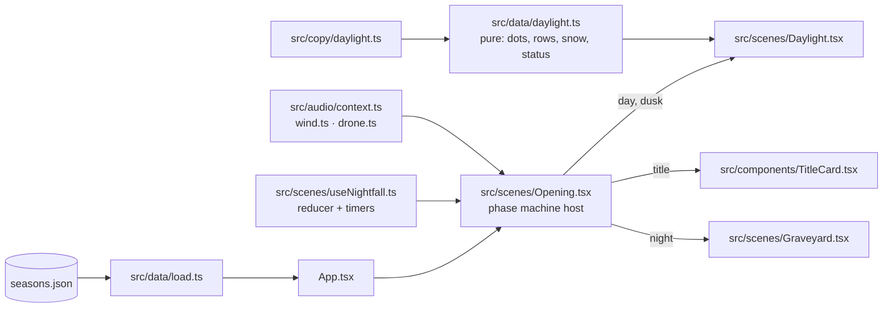

# Design Document

daylight-nightfall

## Overview
Spec 04 adds three things in front of the spec 03 graveyard:
- **Daylight:** the "Boreal Fire Watch" viewer (board `dayOn`, L492–573).
- **Nightfall:** the phase machine and its motion (board `nightfall()`, L676; CSS `rv-dusk`, `rv-sunset`, `rv-dot`).
- **Title card:** board `intro`, L574–583.

It also adds the first two sounds, the wind and the drone.

**Immersion decision (user, 2026-11-17).** The opening is one fixed path. There is no skip (no Escape, no button, no URL parameter in production) and no way to turn the sound off. The board's daylight sound toggle and its night header Sound button are left out, here and in spec 05. The dev server alone accepts `?intro=0`, for screenshot checks.

The board is the visual spec. Its inline styles are the exact look, and `renderVals()` → `day: {…}` (L1353–1359) says how each value is derived. The app is new code, and no board script is pasted in (AGENTS.md).

### Not in this spec
| Feature | Board refs | Spec |
|---|---|---|
| Gravekeeper nightfall line ("You were looking at fire scars. Look again. …") | `say()` in `nightfall()` L683 | 06 (narrator panel and wager; the line ends "Wager with me") |
| Sting and bell when night begins | `playSting()`, `playBell(1)` L684 | 05 |
| Phone daylight / crew view | `Phone.dc.html` | 07 |

Both seams are an `onNight()` callback fired once when the phase reaches `night`.

## Board-to-app decisions
| Board | Problem | App |
|---|---|---|
| Chip "Live · updated 12 min ago" | Invented, and the view shows Mar 21, 2024, not now | "Spring 2024 archive", same chip style (green dot, `#E9F6EF` / `#17734A`) |
| "Active hotspots **0**" with a flat sparkline | No dated, region-wide hotspot count for Mar 21 is published, and `early_hits` (G-01 has 4) has no dates | "Re-ignited burn areas": graves with `rise.day ≤ 0` (0 in the data); the flat line stays |
| "Burn areas 24 · all inactive" | Fine if derived | `graves.length`; "all inactive" when the re-ignited count is 0, else "{n} active" |
| Status "All clear. Fire season has not begun. Snow still covers most of last year's burn areas. No active hotspots in the region." | "Season has not begun" and "no hotspots in the region" are not in the data | "All clear" when the re-ignited count is 0. Text: "No burn area has re-ignited. Snow still covers {covered} of last year's {n} burn areas." `covered` = areas whose opening-week snow ≥ 50 % |
| `snowAvg`: per grave, max of days 0–4, then summed and divided by 24 | Max overstates the snow. Dividing by 24 counts missing areas as 0 | Per area: mean of its valid days 0–6. Card: mean over areas that have a value, labelled "avg, Mar 21–27" |
| Rows: 5 largest, "snow {max}%", bar width = max | As above | Same 5 rows, mean value, bar width = value %. "no data" with an empty bar when there is no valid day |
| Scale bar 60 px "~60 km" | Fixed pixels; true only at one map width | Bar width `5.82cqw` on the map container (`container-type: inline-size`). 60 km ÷ 0.972 km/px = 61.7 grid px = 5.82 % of 1060. Label "60 km" |
| Image credit "Imagery NASA GIBS · VIIRS · Mar 25, 2024" | Correct (keyframe s2024[0]) | Built from `KEYFRAMES.s2024[0]` and `FRAME_SATELLITE` |
| Layer label "2023 fire footprints" | Scars are NBAC now | "2023 burned areas (NBAC)" |
| Layer label "Hotspots, last 24 h" | Implies a live feed | "Hotspots (VIIRS)" |
| Credit "Data: NASA FIRMS / VIIRS 375 m, NASA GIBS. Hotspots refresh hourly." | Missing NBAC; "hourly" is false (the pipeline runs nightly, and this view is an archive) | "Data: NASA FIRMS (VIIRS 375 m), NASA GIBS, NBAC (NRCan). Method after Scholten et al. 2021." |
| Title "> ignoring {RV_RAW.static} gas flares" | 320 is the research count, and FIRMS types 2/3 are wider than gas flares | "> ignoring {seasons.static} static heat sources ........... listening for heat" (591) |
| `#8696A3` credit, `#7A8B99` search text on `#F3F5F7` / `#F1F4F7` | 2.8 : 1 and 3.3 : 1, which fail AA | `#5F7181` (5.0 : 1) |
| Buttons 38 px | Under the 40 px target (AGENTS.md) | `min-height: 40px` |
| `role="dialog"` on the daylight view | It is the page, not a dialog | `<main aria-label="Boreal Fire Watch, daylight view">` |
| `showIntro` design lever | Would let viewers skip the reveal | Always on in production. Dev server only: `?intro=0` (`import.meta.env.DEV`), and spec 03's `?season=` / `?day=` set the start after nightfall |
| Daylight "Sound: on (recommended)" toggle (L566), `daySound` | User decision: sound is not optional | Removed. Sound always starts on the Night shift click |
| Night header Sound button (L127), `toggleSound` | User decision | Not built, here or in spec 05 |
| Reduced motion: `.rv-dusk{animation:none}` | Daylight would sit frozen for 3.2 s, then cut | A 3.2 s opacity fade to black (`rv-duskfade`), no filter, sweep or sink |
| Nightfall line, sting, bell | Owned by 06 and 05 | `onNight()` seam |
| Browser tab title (not on the board) | "Revenant · …" in the tab gives the reveal away | `index.html` says "Boreal Fire Watch"; `Opening` sets `copy.docTitle.night` from the title card on (Requirement 2.6) |
| Night fonts (not on the board) | Browsers load a face only when text first uses it, so IM Fell would flash in Georgia at the reveal | `Opening` calls `document.fonts.load()` for the night faces while daylight is up |

Kept verbatim from the board or brief: "Boreal Fire Watch", "Northeast BC & Northern Alberta", "Search a place, burn area or coordinates", "Regional status", "Monitored burn areas", "View all 24", "Inactive", "Night shift starts at 19:00", "Some crews keep watch after dark.", "Stay until dark", "Night shift", "> same satellites · same data · after dark", "Not every fire goes out in the fall.", "Some wait under the snow.".

## Architecture


### Files
| File | Contents |
|---|---|
| `src/copy/daylight.ts` | Every daylight and title-card string and template |
| `src/data/daylight.ts` | `daylightView(season, static, keyframe)` → `{ dots, rows, snowAvg, covered, reignited, clear, dateLabel, credit, imageCredit }`, plus `SCALE_60KM_PCT` |
| `src/scenes/useNightfall.ts` | `Phase`, `nightfallReducer`, `initialPhase(search, dev)`, `useNightfall({ onNight })` with timers |
| `src/scenes/Opening.tsx` | Picks the scene by phase, starts the sound in the Night shift click, and hands focus to the title card and then the headline |
| `src/scenes/Daylight.tsx` | The `dayOn` markup, without the sound toggle |
| `src/components/TitleCard.tsx` | The `intro` markup. No controls; the card itself takes focus |
| `src/audio/context.ts` | `getAudio()`: one lazy AudioContext with resume. Returns `null` when unavailable |
| `src/audio/wind.ts` | `startWind()` (board `startAudio`). `stopWind()` exists only for unmount cleanup in tests and HMR; the UI never calls it |
| `src/audio/drone.ts` | `playDrone()` (board `playDrone`) |
| `src/styles/daylight.css` | Daylight focus outline |
| Changes | `App.tsx` renders `Opening`. `Graveyard` takes `headlineRef`. `useGraveyard.initialState` reads `?season=` / `?day=` in dev only. `motion.css` gets the board's `rv-dusk`, `rv-sink` / `.rv-dusk .rv-dot`, `rv-sunset`, `rv-introfade`, plus `rv-duskfade` for reduced motion |

## Phase machine
```
day ──nightfall──▶ dusk ──3200 ms──▶ title ──6000 ms──▶ night
```
- **Events:** `nightfall`, `duskDone`, `titleDone`. There is no skip event.
- **Transitions:** `nightfall` only works from `day`, `duskDone` only from `dusk`, and `titleDone` only from `title`. Any other event leaves the phase unchanged, and `night` absorbs everything.
- **Reduced motion:** the same timings. Only the CSS differs (Requirement 9).
- **Timers:** the hook sets one timer per phase and clears it on phase change and unmount. Nothing can run twice.
- **`initialPhase(search, dev)`:** `'night'` only when `dev && search has intro=0`, otherwise `'day'`. `dev` is `import.meta.env.DEV`, so the production bundle never reads the parameter.
- **`onNight`:** called once, on entering `night` by the timer. It is not called when the dev server starts at night.

## Sound
- **No state and no controls.** Sound is always on (immersion decision).
- **On nightfall:** the Night shift / Stay until dark click handler calls `getAudio()` (create or resume, inside the gesture), then `startWind()` and `playDrone()`, and then dispatches `nightfall`. A second click does nothing, because `startWind()` returns early when the wind is already running and the reducer ignores the event.
- **Wind** runs from nightfall for the rest of the visit.
- **Failures:** every audio call is wrapped in try/catch and returns quietly.
- **Values:** the board's `startAudio` (L798) and `playDrone` (L687), which match design-reference.md ("Wind", "Nightfall drone").
- **Caveat for the write-up:** WCAG 1.4.2 (Audio Control) asks for a way to stop audio that plays for more than 3 s. The sound here starts from a user click, not on page load, and the browser's tab mute still works. This was a deliberate costume choice.

## Daylight derivations
Using `s = seasons.s2024`, and `week(g)` = the valid values of `g.snow[0..6]`:
- `area(g) = week(g).length ? round(mean(week(g))) : null`
- `snowAvg = round(mean(area(g) for g where area(g) ≠ null))`, or `null` when no area has data. The card then shows "no data".
- `covered = count(area(g) ≥ 50)`, `reignited = count(g.rise && g.rise.day ≤ 0)`, `clear = reignited === 0`
- `rows = graves[0..4]` (published order = largest first): `{ id: 'BA-nn', km: km2(size), snow: area }`
- `dots = graves.map((g, i) => ({ x: g.cx, y: g.cy, id: 'BA-nn', label: i < 8 }))`, with the label at `(cx + 11, cy + 4)`
- `dateLabel = 'Thu, Mar 21, 2024'`, from `Date.UTC(2024, 2, 21)` with weekday names, so it doesn't depend on the local time zone

Published values today: snowAvg 80, covered 20 of 24, reignited 0.

## Correctness Properties
*A property is a characteristic or behaviour that should hold true across all valid executions of a system: a formal statement about what the system should do. Properties are the bridge between human-readable specifications and machine-verifiable correctness guarantees.*

Each property is one fast-check test (≥ 100 runs) over random seasons: 1–24 graves, snow series of 103 values in −1..100, and rises of 0 or a `[day, x, y]` in 0..102.

- **Property 1: area snow is the opening-week mean.** For any grave, `area(g)` is null exactly when days 0–6 have no valid value. Otherwise it is in 0..100 and equals the rounded mean of the valid values. **Validates: Requirements 3.2**
- **Property 2: the average ignores missing areas.** `snowAvg` equals the rounded mean of the non-null area values, lies between their minimum and maximum, and is null only when all are null. **Validates: Requirements 3.3**
- **Property 3: all clear means no re-ignition.** `clear` is true exactly when no grave has `rise.day ≤ 0`. `reignited + inactive = graves.length`, and `covered ≤ graves.length`. **Validates: Requirements 3.4, 3.5, 3.6**
- **Property 4: the phase moves one step at a time.** For any sequence of events from any start phase:
  - the phase index never decreases, and it rises by at most one per event;
  - reaching `night` from `day` takes exactly `nightfall`, `duskDone`, `titleDone`, in that order;
  - `night` absorbs every event.

  **Validates: Requirements 4.2, 4.3, 6.1**
- **Property 5: no number without a source.** Every digit run in the daylight copy output is one of: the inputs (sizes as km², snow values, counts, `static`), the dates derived from day 0 and the keyframe, or the fixed labels "24" (grave count), "19:00" (brief), "60 km" (scale), "375 m" (sensor) or "2021" / "2023" / "2024" (credits and years). **Validates: Requirements 3.9**

Example tests:
- the date label and the scale constant (5.82 %);
- `initialPhase('?intro=0', false)` is `day`, and `initialPhase('?intro=0', true)` is `night`;
- `initialPhase('?season=s2025&day=40', false)` is `day`;
- `onNight` fires exactly once, after 9.2 s;
- Escape, clicks and repeated Night shift presses during dusk and title don't change the timing;
- the audio functions don't throw when `AudioContext` is undefined (jsdom).

## Testing
- **Vitest + fast-check:** `src/data/daylight.test.ts` (Properties 1–3, 5 and the examples) and `src/scenes/useNightfall.test.ts` (Property 4; the timer path with `vi.useFakeTimers()`).
- **@testing-library/react:**
  - Opening renders Daylight, and pressing Night shift leads to the title card and then the graveyard (fake timers).
  - Escape does nothing during nightfall.
  - The title card has no buttons, and focus lands on the card, then on the headline.
  - There is no sound control anywhere in the DOM.
- **Build check:** after `npm run build`, `dist/assets/*.js` contains no `get("intro")` and no `get("season")`. This shows the dev-only switches were compiled out.
- **Playwright (manual checkpoints):** daylight at 1440 × 1000, then nightfall frames at 0 / 1.6 / 6.2 / 9.2 s, with normal and with reduced motion.

## Error handling
- **Data:** a data failure keeps the spec 03 error stone (App.tsx). Daylight never renders without `seasons.json`.
- **Images:** a missing keyframe leaves the `#CFD8DC` map background, as on the board. No placeholder numbers are shown.
- **Audio:** an audio failure is silent (Requirement 7.3).
