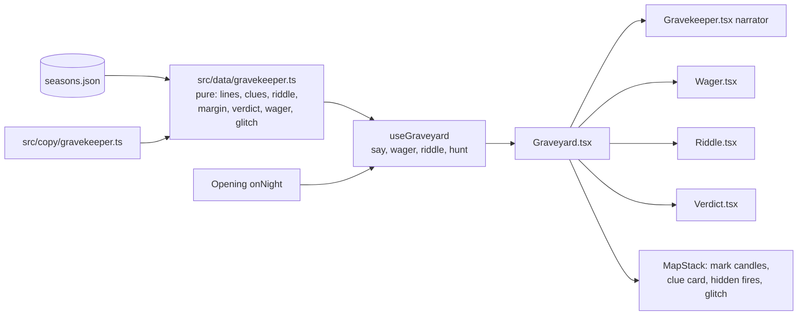

# Design Document

gravekeeper-and-wager

## Overview
Spec 06 adds a voice, three puzzles and a verdict to the graveyard. It plugs into the seams left by earlier specs:
- spec 04 `onNight` (night arrival);
- spec 05 `onRising` (each rising), `startGate` (the wager at day 0) and `clockMayAdvance` (the clock waits while the riddle is open);
- spec 03's lantern and stone buttons.

Pure functions in `src/data/gravekeeper.ts` decide every line, card, score and margin from published data. Components render them, and `useGraveyard` owns the state.

## Board-to-app decisions
| Board | Problem | App |
|---|---|---|
| 2024 intro "…\nPress play, and watch the snow." | There is no play button (spec 05) | "…\nMark three, or just watch the snow." |
| 2026 intro "The scars of 2025. Fewer, and smaller." | Every season has 24 graves, so "fewer" is false | Built from data: "{n} more, from the fires of {Y−1}. A gentler/harder summer: about {km} km² here, where {Y−2} left {km′}." The published sizes give 2024 → 2025: 34,600 → 13,500 km² and 2025 → 2026: 13,500 → 11,600 km² (both gentler) |
| 2025 intro "A gentler summer." | True in the bbox, but stated without a measure | Same template as 2026, so the claim carries its numbers |
| Verdict detail "…a zombie year, after the great fires of 2023." | Wrong for Spring 2025 (scars of 2024) | "…a zombie year, after the fires of {Y−1}." |
| `quiet()` = season 2025 or 2026 | Hard-coded and now wrong: 2025 beats chance in the published data | `!season.zombie` (only 2026 today) |
| Wager clue "the biggest scars, where the snow leaves first" | Steers the viewer with a claim the data doesn't make | Neutral: "Read the stones: size, latitude, thaw and early heat. Hover or focus one." |
| Tooltip line "Footprint ~{km} km² · {lat}°N · click to mark it" | Shows only size and latitude | The clue card adds the melt date and the early-heat count (`early_hits`) |
| Verdict wager line | Compares with blind chance only | Also names the Gravekeeper's own bet (the three largest), so the viewer has a rival |
| Thin margin | Not shown | Added when 1–2 graves would flip the verdict (method.md: say the 2025 margin) |
| `RV_RISE_LINES` "{days}" uses the lead's count | The same shared-day error as spec 05's sting | Each line names the lead and the lead's own count |
| Glitch text replaces the live text | Screen readers would read ▓▒░ | Glitch is visual only. The live region and labels keep the true text |

Kept verbatim: the night line (with `{n}` and `{Y−1}` from data), the first-thaw line, the three beat lines, the five later-rising lines, "Your mark…", the lantern line, the four whispers, the four wager verdicts, the verdict lines, "Again, then. Mark three, or just watch.", "Sealed: …\nNow we watch the snow.", "The Gravekeeper's wager", "Seal the wager", "Just watch" and "Dig them up again".

## Architecture

### Files
| File | Contents |
|---|---|
| `src/copy/gravekeeper.ts` | All lines and card texts |
| `src/data/gravekeeper.ts` | The pure functions in tasks.md 1.2 |
| `src/components/Gravekeeper.tsx` | Narrator panel (board `hasSay`) |
| `src/components/Wager.tsx` | Wager panel (board `wagerOpen`) and `ClueCard` |
| `src/components/Riddle.tsx` | Riddle dialog |
| `src/components/Verdict.tsx` | Verdict card (board `hasVerdict`) |
| Changes | `useGraveyard`: `say`, `wager`, `riddle`, `found`, `woke`, and the verdict at day 102. `MapStack`: mark candles, hidden fires, the `rv-glitch` class. `Register`: glitched row text. `Opening`: night line. `motion.css`: reduced-motion rules for the new classes |

## State
- `say: { text, who: 'keeper' | 'whisper', start, until } | null`. Set by `say` actions, cleared by a timer at `until`.
- `wager: { marks: string[], sealed: boolean, open: boolean }`.
  - `open` is true at day 0 of each replay and drives `startGate = !open`.
  - `seal` sets `sealed` and closes the wager. `watch` closes it with no marks.
  - A scrub past day 0 while `open` counts as `watch`.
- `riddle: { id, picked: string[], hint: string | null, done: boolean } | null`.
  - It opens after beat 1, when the beat's camera hold ends.
  - `clockMayAdvance` also needs `riddle === null`.
  - It is solved once per replay: `done` survives until the replay restarts.
- `found: string[]`: new fires found under the lantern. Reset with the season.
- `woke: boolean`: the first-thaw line was said. Reset with the replay.
- `verdict: boolean`: set when the clock reaches day 102 with the season not Tonight.

## Pure logic (highlights)
- **`introLine(seasons, key)`:** compares the sum of published `size` for this season with the previous season's (km² via `km2`). It returns the 2024 line, or the template line for later years.
- **`margin(season)`:** the smallest k ≥ 1 with `(risen − k)/n ≤ 1.4·chance`. It returns `null` when the season is quiet, or when k > 2. Spring 2025 gives k = 2 (9 → 7 risen, 29.2 % < 30.1 %).
- **`gravekeeperGuess(season)`:** the first three graves in published order, which are the largest.
- **`wagerScore(season, marks)`:** `{ k, blind: 3·risen/n, guess }`.
- **`riddleCards(year, proximityKm)`:** the three truths and one decoy, `decoys[year % 3]`, in an order shuffled by an LCG seeded with the year. `checkRiddle(picked)` is true iff the picked set equals the three truths.
- **`clueCard(grave, year)`:** `{ km, lat, thaw, early }` strings from published fields only.
- **`glitchText(s, seed)`** (board `rvGlitch`): replaces 22 % of non-space characters. `glitchOn(now)` is `floor(now/110) % 46 < 3`.
- **`whisperAt(day, season)`:** returns a whisper when the season is quiet and `day ∈ {22, 48, 76}`, chosen by `(day·7) % 4`.
- **`lanternRadius(marks, season, day, sealed)`:** `130 + 30·(marks risen by day)` when sealed, otherwise 130.
- **`fireFound(fire, lx, ly, r)`:** true when `hypot(fire − lantern) < r − 10`.

## Correctness Properties
*A property is a characteristic or behaviour that should hold true across all valid executions of a system: a formal statement about what the system should do. Properties are the bridge between human-readable specifications and machine-verifiable correctness guarantees.*

- **Property 1: lines carry only published numbers.** For any season and event, every digit run and number word in a generated line is one of:
  - the grave's id;
  - its own day count;
  - the season's counts, years, chance %, or areas from sizes;
  - the fixed "50" and the proximity km.

  **Validates: Requirements 2.2–2.4, 2.7, 7.2–7.5**
- **Property 2: quiet years follow the flag.** For any season, whispers and the glitch occur iff `zombie` is false. The verdict line is the zombie line iff `zombie`. **Validates: Requirements 3.1, 7.2, 7.3**
- **Property 3: the margin is exact.** `margin` returns k iff `(risen − k)/n ≤ 1.4·chance < (risen − k + 1)/n` with k ∈ {1, 2}. Otherwise it returns null. **Validates: Requirement 7.4**
- **Property 4: the riddle accepts only the truth.** For any subset of the four cards, `checkRiddle` is true iff it is exactly the three true ones. The order is a permutation fixed by the year. **Validates: Requirements 5.2, 5.3**
- **Property 5: wager scores are bounded.**
  - `k` and `guess` are in 0..3;
  - `k` = marks that rose;
  - `blind = 3·risen/n`;
  - `lanternRadius` is in {130, 160, 190, 220} and never decreases with the day.

  **Validates: Requirements 4.5, 7.5**
- **Property 6: clue cards are data.** For any grave, the clue card's numbers are the grave's km² (from size), latitude, melt date and `early`. No other digits. **Validates: Requirement 4.3**
- **Property 7: the glitch stays visual and slow.** `glitchText` keeps length, spaces and newlines. It changes at most 22 % + 1 of the characters. `glitchOn` is true in at most 3 of every 46 ticks of 110 ms, i.e. under 1 window per 5 s. **Validates: Requirements 3.3, 3.4**

Example tests:
- 2025's margin is 2;
- 2024's Gravekeeper's guess got 3 of 3;
- 2026's is 0, and 2026 is quiet;
- the 2025 intro says "gentler" with 13,457 / 34,604 km² rounded by `km2`;
- the night line names 24 and 2023.

## Testing
- **Vitest + fast-check:** `src/data/gravekeeper.test.ts`.
- **@testing-library/react, fake timers:** `Graveyard.test.tsx`. Check that:
  - the wager holds day 0;
  - marking takes three, and seal starts the replay;
  - the riddle opens after the beat 1 hold and holds the clock;
  - a right answer opens G-10's exhumation;
  - the 2024 verdict is a zombie verdict with three bells, and the 2026 verdict is quiet.
- **Playwright checkpoints** as in Requirement 9.
