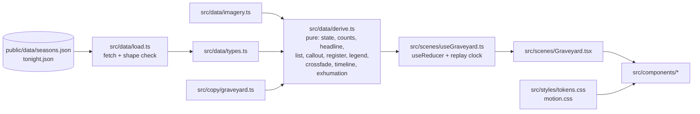

# Design Document

graveyard-map

## Overview

Spec 03 builds the night graveyard scene of `reference/design/Main.dc.html` as a React 19 + Vite + TypeScript app. It uses plain CSS, with the design tokens as CSS variables. The scene contains:
- **Header:** the brand, the season tombstone tabs, and iron-plate buttons for Lantern, Before / after and Night view.
- **Headline band:** a headline and a row of counts.
- **Map:** VIIRS keyframes crossfading by day, scar masks, fog, snowfall, grain and vignette. Tombstones, new-fire candles, a callout and a tooltip sit on top. The lantern, before/after split and exhumation panel open over it.
- **Right column:** the Parish Register, the carved grave cards and the legend.
- **Footer:** the candle timeline, with play, ½×/1×/2× speed and scrubbing.

The board is the visual spec. Its inline styles are the exact look, and `renderVals()` defines how each value is derived. The app is new code: no board script is pasted in (AGENTS.md). Every number comes from `public/data/*.json` (honesty.md). The board's embedded `RV_RAW`, `RV_CHANCE` and hard-coded strings are replaced by published fields or by templates in `src/copy/`.

### Not in this spec (owners in brackets)
| Feature | Board refs | Spec |
|---|---|---|
| Daylight "Boreal Fire Watch", nightfall, title card | `dayOn` L492, `intro` L574, `nightfall()` | 04 |
| Rising cinematic, camera zoom, letterbox, sting, shake; bell, boom, creak (wind and drone moved to spec 04; no Sound button, by the spec 04 immersion decision) | `camOn` L209/L263, `hasSting` L300, `playBell` etc. | 05 |
| Gravekeeper narrator, whispers, quiet-year glitch, wager, verdict | `hasSay` L308, `wagerOpen` L326, `hasVerdict` L290 | 06 |
| Tonight footer countdown, staleness, crew phone, dossier, opening frame | `isTonight` L484, other boards | 07 |

Spec 03 leaves a seam for each of these: a slot in the map overlay stack, and callbacks on the replay clock (`onDay`, `onRiseCrossed`). The later specs plug into those without reworking the scene.

## Board-to-app decisions

| Board | Problem | App |
|---|---|---|
| `RV_RAW`, `RV_SEASONS` (research data) | Not published data | `public/data/seasons.json` via `src/data/load.ts` |
| `RV_CHANCE` constants | Not published | `season.chance` |
| Register footnote "Only the spring after the great fires of 2023 beats chance." | Now false: 2024 **and** 2025 beat chance | Template built from each season's published `zombie` flag (see Copy) |
| Register bar colour `obs > ch * 1.4` | Recomputes the rule | Use the published `zombie` flag |
| Tab sub "LIVE · OCT 28" | Hard-coded date | `LIVE · ` + `tonight.points_through` (e.g. `LIVE · NOV 16`) |
| `staticNote` "320 recurring heat points … 3 of 4 years" | Wrong number and wrong rule for the build | `{static} places FIRMS flags as static heat (gas flares, plants) are ignored.` (`seasons.static` = 591) |
| Legend "Scar: where VIIRS saw fire, May–Oct {Y−1}" | Replay scars are NBAC now | "Scar: burned area mapped by NBAC (NRCan), {Y−1}". Tonight: "where VIIRS saw fire, May–Oct 2026" |
| Legend "Buried: snow cover on the scar ≥ 15%" | Buried means "melt day not reached" | "Buried: snow has not yet left the scar for a week" |
| Rule check "a hotspot within ~3 km of the scar" | The build is ≈ 1 km | "within ≈ 1 km of the scar" (`meta.proximity_km`) |
| Rule check "VIIRS saw fire across ~{km} km²" | NBAC scar | "NBAC mapped ~{km} km² burned here in {Y−1}." km² = `size_px` × 0.9, as `rvKm` (1 px ≈ 0.97 × 0.93 km at 57° N) |
| `RV_IMG` keyframe ids and days | No image manifest in `public/data/` | `src/data/imagery.ts`: file names from `reference/design/blob-map.json`, days from `public/img/README.md` (4/28/89, 9/34/92, 5/25/84). Tonight uses `viirs-latest.webp` and `tonight.frame_date` |
| `RV_TONIGHT` score `/1202`, `/120` | Normalised to research maxima | Normalise by the maximum `size_px` and `late_hits_14d` in `tonight.json`: score = 0.45·size/max + 0.55·late/max |
| `checkRise`, cinematic | Spec 05 | The clock emits `onRiseCrossed(ids)`. Spec 03 only shows the static Risen marker (hand, embers, pulse, cracks) |
| `togglePlay` wager gating | Spec 06 | Play simply plays |
| `showIntro` default true (starts in daylight) | Spec 04 | The app starts at night until spec 04 lands |
| Replay speed (design-reference.md says 0.75 / 1.5 / 3 days/s) | Board `RV_PERIOD` is 1300 / 650 / 325 ms per day = 0.77 / 1.54 / 3.08 days/s | Use `RV_PERIOD` (the board's behaviour); footer text keeps the board's "0.75 / 1.5 / 3 days a second" labels |

## Architecture



### Module layout
```
index.html                       # Google Fonts link (IM Fell English, IM Fell English SC, Inter, JetBrains Mono)
src/main.tsx                     # mounts <App/>
src/App.tsx                      # loads data, shows Graveyard (or a loading/error stone)
src/styles/tokens.css            # CSS variables from docs/design-reference.md
src/styles/motion.css            # rv-* keyframes used here + the board's prefers-reduced-motion block
src/styles/base.css              # body, focus-visible, rv-tab/rv-btn hover rules (board helmet L12–14, L100–102)
src/data/types.ts                # Season, Grave, NewFire, Tonight, TonightScar, Meta
src/data/load.ts                 # fetch('/data/seasons.json'), fetch('/data/tonight.json'), parse rows into objects
src/data/imagery.ts              # keyframes per season, mask file per season, Tonight frame
src/data/state.ts                # displayState(day, melt, rise): buried | waking | risen | rest (no other rule logic)
src/data/derive.ts               # pure functions ported from renderVals(), one per region
src/data/format.ts               # rvFmt, rvIso, coords, km, region (BC/AB at x = 374), number words
src/copy/graveyard.ts            # every visible string and template for this scene
src/scenes/useGraveyard.ts       # state (useReducer), replay clock, handlers
src/scenes/Graveyard.tsx         # page layout
src/components/IronButton.tsx    # btn(on) style
src/components/SeasonTabs.tsx
src/components/MapStack.tsx      # images, grade, scars, fog, border, flakes, grain/vignette, credit
src/components/Tombstone.tsx     # one grave's SVG group
src/components/Candle.tsx        # new fire triangle + flame
src/components/Callout.tsx
src/components/Tooltip.tsx
src/components/Register.tsx
src/components/GraveCard.tsx
src/components/Legend.tsx
src/components/CandleTimeline.tsx
src/components/Lantern.tsx
src/components/Compare.tsx
src/components/Exhumation.tsx
src/**/*.test.ts                 # Vitest + fast-check
```

### Scaling
The board fixes nothing in pixels on the map.
- **Map box:** `flex: 999 1 560px; aspect-ratio: 1060 / 716`.
- **SVG layers:** each uses `viewBox="0 0 1060 716"` at 100 % × 100 %.
- **HTML overlays:** buttons, callout, tooltip and lantern names use percentages: `x / 1060 * 100`, `y / 716 * 100`.
- **App:** keeps the same approach, so the scene is fluid at 1280–1920 px.
- **Grid coordinates:** in the data they map straight to SVG coordinates.

### State (`useGraveyard`)
```ts
type Season = 's2024' | 's2025' | 's2026' | 'tonight';
interface UIState {
  season: Season; day: number /* 0..102 */; selected: string /* 'G-01' */; playing: boolean;
  speed: '0.5' | '1' | '2'; night: boolean; lantern: { on: boolean; x: number; y: number; inside: boolean };
  compare: boolean; split: number /* 2..98 */; ex: string | null; hover: string | null; fireSel: string | null;
}
```
Initial state is the board constructor's: `day: 0, selected: 'G-01', speed: '1', night: true, lantern (530, 358), split: 50`.

The **replay clock** uses one `setInterval` of 100 ms, as the board does.
- It adds 100 ms per tick. When the total reaches `RV_PERIOD[speed]`, it advances `day` by 1.
- At day 102 it stops. Pressing play again restarts from day 0.
- It calls `onRiseCrossed(fromDay, toDay)` for later specs.
- Scrubbing sets `day` directly.

Switching season sets `day 0`, stops playback, sets `selected 'G-01'`, closes the exhumation panel, turns the compare split off and clears the fire selection.

### Derivations (`src/data/derive.ts`; each mirrors a block of `renderVals()`)
- `displayState(d, melt, rise)` (board L884–888):
  - `melt < 0 || d < melt` → buried
  - `rise && d ≥ rise.day` → risen
  - `d − melt > 50` → rest
  - else waking
  - `since = max(0, d − melt)`

  This is the published rule's display mapping, with no other logic.
- `graveView` (board L898–956). It returns the label (BURIED / WAKING / RESTLESS when `since ≥ 30` / RISEN / LAID TO REST), colour, stroke and fill, and the paths.
  - **Paths:** tomb, cross, cap, steam, cracks, smoke and hand (`rvHand`).
  - **Glow radius:** `round(12 + sqrt(size)/4.5)`.
  - **Snow cap opacity:** 1 while `d < melt − 3`, then `(melt − d)/3`, then 0.
  - **Thawing:** `melt − 2 ≤ d ≤ melt + 2`.
  - **Sinking:** in rest, the stone moves down 5 px at 45 % opacity.
  - **Emerge delay:** `0.15 + i·0.07` s.
- `fires` (L961–981): shown when `d ≥ first_day`, with the triangle and flame paths. The hit button is 28 px.
- `callout` (L985–1022): the text lines per state, the box is 266 × 128 and clamped inside the map, and a dashed leader line runs to it. It is hidden while the exhumation panel or lantern is open.
- `list` (L1026–1052): sorted by state (risen, then waking, then buried, then rest), then by rise day descending, then `since` descending, then size descending. Each card carries its border, window bar, day text and epitaph. In Tonight the list is the watch list, sorted by score.
- `headline` / `subline` / `counts` (L1054–1075): uses number words.
- `crossfade(d, keyframeDays)` (L1078–1088): returns weights. Compare mode shows the last keyframe under the first.
- `register` (L1218–1228): `obs = risen/24`, `chance`, text "{N} rose · {round(chance·24)} by chance". The strong red bar is used when `zombie`.
- `legend` (L1230–1243), `timeline`, `band` and `riseMarks` (L1203–1209, L1393–1399), and `candle` (L1263–1268).
- `exhumation` (L1131–1197):
  - **3 crops:** each at 2.6× zoom on the rise point (or the centroid).
  - **Snow curve:** `x = i/102·300`, `y = 58 − v/100·50`, skipping −1 values.
  - **Melt line and 50-day band:** `winW = min(300 − mx, 50/102·300)`.
  - **Rise marker:** a triangle.
  - **3 rule checks** and the epitaph.
- `lantern` (L1108–1119): radius 130 (spec 06 adds 30 per wager hit). Names are shown within `LR − 10`, at most 5.
- `flakes` (L1200–1205): `count = d > 40 ? 0 : round(snowfall·(1 − d/40))` with `snowfall = 30`. Tonight uses `round(30·1.4)`.

## Components and Interfaces

Each component takes plain props from `derive.ts` and holds no data logic. The styles are the board's inline values, moved into CSS classes, and colours use token variables. Key values:

| Component | Board values (verbatim) |
|---|---|
| Header | `padding: 12px 28px; border-bottom: 1px solid #172120; background: #060A09`. Brand: IM Fell English SC 28 px, letter-spacing 4 px. Tagline: italic 13.5 px `#A3ADA8` "What burned last summer is not always dead." |
| SeasonTabs | `min-height: 50px; min-width: 98px; padding: 9px 14px 7px; border-radius: 26px 26px 3px 3px`. On: border = accent (teal for Tonight), glow `0 0 16px rgba(255,107,44,0.2)`. Label: IM Fell SC 17 px. Sub: JetBrains Mono 10 px |
| IronButton | `btn(on)`: min-height 40 px, radius 3 px, rivets as two radial-gradients, `inset 0 1px 0 rgba(255,255,255,0.07), 0 2px 0 #000`. On: border `#8A5A45` + ember glow. Font: IM Fell SC 14 px |
| Headline band | Headline IM Fell SC 44 px, letter-spacing 2 px, ember glow when risen > 0. Subline italic 18 px `#C7CFCB`. Counts JetBrains Mono 12 px |
| MapStack | Grade overlay `#04121A`, multiply, opacity .45. Scars `#B4461A`, opacity .42, screen (true colour: `#E0561C`, .35). Fog: 3 radial gradients, opacity .5, `rv-fog 38s`. Grain: feTurbulence at opacity .06. Vignette: radial r .78. 120° W dashed line at x = 374. Province labels. Credit chip at bottom right |
| Tombstone | Tomb arch 16 × 13 px around (cx, cy). Snow cap stroke 3 px `#F1F6F6`. Risen: pulse r = 34, core r = 20, cracks, smoke, hand stroke 2.2 px accent, embers |
| Callout | `border-radius: 40px 40px 4px 4px`; `padding: 18px 18px 12px`. Gradient `rgba(22,28,26,0.96) → rgba(7,11,10,0.96)`. Status: Mono 11 px, letter-spacing 3 px. Title IM Fell SC 22 px |
| Register | Ruled parchment: `repeating-linear-gradient(... 25px ... rgba(216,200,160,0.07) 26px)` over a radial `#2A2418 → #18140D → #100D08`, border `#3A3022`. Observed bar: `#6E1E12 → #C2472C` (or `#8E3A26`). Chance bar: dashed `#B8A880` 6 px on / 3 px off |
| GraveCard | `border-radius: 70px 70px 4px 4px; padding: 20px 20px 14px`. Risen: `0 0 24px rgba(255,107,44,0.20), inset 0 -22px 26px -14px rgba(255,107,44,0.45)` |
| Legend | Parchment `#221E15 → #14110B`, title "Every symbol is a rule" |
| CandleTimeline | Play button 50 px round. Wax `#F2EAD6 → #DCD0B0 → #B4A57E`, 13 px high, from the playhead to the end. Melted stub 4 px. Flame SVG at the playhead. Drips 6 px wide at each crossed rise day. Teal 50-day band for the selected grave. Month ticks at Apr 1 10.8 %, May 1 40.2 %, Jun 1 70.6 % |
| Exhumation | `width: min(400px, 92%); border-radius: 120px 120px 10px 10px`. `rv-slide .45s`. 40 px close button |
| Lantern | Veil radial: 0.10 warm centre → 0.93 dark at 12 %. True-colour image clipped to `circle(LR·0.9)`. Ring `#FFD9A0`. Names IM Fell SC 15 px `#FFE7C2` |
| Compare | Last keyframe base, first keyframe clipped `inset(0 {100−split}% 0 0)`. 2 px bone divider. Mono tags |

`src/components` takes props in, and handlers come from `useGraveyard`. No component fetches data or reads the clock.

## Data Models

```ts
// src/data/types.ts — parsed from the published rows (docs/method.md, "Published schema")
interface Grave { id: string; size: number; cx: number; cy: number; melt: number /* -1 = never */;
  rise: { day: number; x: number; y: number } | null; early: number; snow: number[] /* 103, -1 = missing */ }
interface NewFire { id: string; x: number; y: number; day: number }
interface SeasonData { year: 2024 | 2025 | 2026; graves: Grave[]; fires: NewFire[]; chance: number; zombie: boolean; risen: number }
interface Meta { generated_at: string; method: string; proximity_km: number; sources: string[]; credit: string }
interface SeasonsFile { seasons: Record<'s2024' | 's2025' | 's2026', SeasonData>; static: number; meta: Meta }
interface TonightScar { id: string; size: number; cx: number; cy: number; lastBurn: string; late: number;
  lateXY: [number, number] | null; snowNow: number /* -1 = unknown */ }
interface TonightFile { scars: TonightScar[]; clusters: [number, number, number][]; static: number;
  asOf: string; frameDate: string; pointsThrough: string; sources: string[]; credit: string }
```
`risen` is the count of graves with a rise. It's a count of published rows, not a rule.

## Copy (`src/copy/graveyard.ts`)

All visible text in this scene comes from this file. It mixes static strings and template functions that take only published values. The texts are the board's, with these corrections, which the honesty-review hook will check:
- **Register footnote:**
  - If no season has `zombie` set: "No spring beats chance. Revenant says so."
  - Otherwise: "Red ink: graves that rose. Faint ink: what chance alone would raise, the same shapes laid on unburned ground." followed by a list of the zombie springs, for example "Springs 2024 and 2025 beat chance."
- **Static note:** "{static} places FIRMS flags as static heat (gas flares, plants) are ignored. White cloud is a blind spot: the satellite cannot see heat beneath it."
- **Rule checks:** the proximity value is `meta.proximity_km`. Scar text names NBAC.
- **Credit chip:** "NASA GIBS · VIIRS true colour, {keyframe label} {Y} · heat: NASA FIRMS · scars: NBAC". Tonight: "NASA GIBS · VIIRS NOAA-20, {frame_date} · heat: NASA FIRMS".

## Correctness Properties

These run on Vitest + fast-check over generated seasons that look like published rows.

### Property 1: Display states are monotonic and cover the season
*For any* grave and days d₁ < d₂ in 0..102, the rank of `displayState(d₁)` is ≤ the rank of `displayState(d₂)`, with ranks buried < waking < {risen, rest}. A grave never shows both risen and rest.
**Validates: Requirements 5.1, 5.2**

### Property 2: Counts add up
*For any* season and day, buried + waking + risen + rest = number of graves, and the headline number word equals the risen count.
**Validates: Requirements 8.1, 8.2**

### Property 3: Crossfade weights are a partition
*For any* day and increasing keyframe days, the weights are ≥ 0 and sum to 1. Only the two neighbouring keyframes are non-zero.
**Validates: Requirement 4.2**

### Property 4: The callout stays on the map
*For any* anchor point on the grid, the 266 × 128 callout box lies inside 8 … 1060−8 × 8 … 716−8.
**Validates: Requirement 7.3**

### Property 5: The list is a permutation in rule order
*For any* season and day, the cards are a permutation of the graves, sorted by state order risen → waking → buried → rest.
**Validates: Requirement 10.1**

### Property 6: Timeline drips only for crossed risings
*For any* season and day, there is a full drip exactly for each grave with a rise day ≤ day, and a faint tick for the rest.
**Validates: Requirement 12.4**

### Property 7: Exhumation chart geometry
*For any* grave, every curve point has x in [0, 300] and y in [8, 58]. The 50-day band starts at the melt x and is at most 50/102·300 wide. Missing (−1) snow days are skipped.
**Validates: Requirement 15.3**

### Property 8: No number without a source
*For any* published files, every number that the copy templates render appears in, or is computed directly from, the published fields passed to them. Each template takes only typed fields from `types.ts`.
**Validates: Requirement 19.1**

## Error Handling
- **Fetch fails or the shape check fails:** a full-page "stone" shows "The register could not be read." and names the file. No partial render with made-up values.
- **A keyframe image fails to load:** the map shows the night background. The credit chip still shows the intended date.
- **Missing Tonight file:** the Tonight tab is disabled, with "No live data yet." The replay seasons still work.

## Testing Strategy
- **Vitest unit tests** for `format.ts`, `state.ts`, `derive.ts` and the copy templates, plus Properties 1–8 with fast-check.
- **Component smoke tests** with `@testing-library/react`: each region renders from a fixture of the real published files, without crashing.
- **Visual check:** Playwright MCP screenshots at 1440 × 1000 for each season and day, compared with the board's markup values. The board can't render on its own: its `support.js` runtime isn't in the repo. Each port step is also shown to the user on `npm run dev` before moving on.
- **Reduced motion:** a Playwright run with `prefers-reduced-motion: reduce` checks that no rv-* animation runs and that every element is in its final visible state.
- **Commands:** `npm run check` (lint + typecheck) and `npm test` (Vitest).
