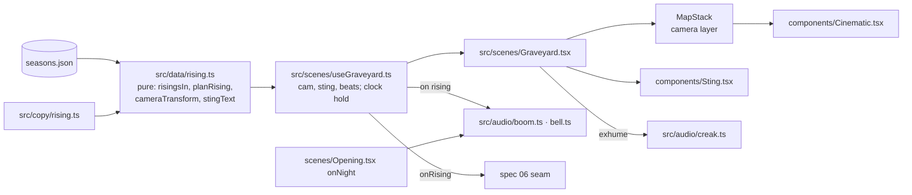

# Design Document

rising-and-sound

## Overview
Spec 05 adds the rising cinematic and three sounds to the spec 03 graveyard:
- **Detection and planning:** pure functions in `src/data/rising.ts` decide, for a forward step of the replay, whether there is a rising and what it gets: the sting, the camera, a beat, the hold length and the bell count.
- **State:** `useGraveyard` gains `cam`, `sting` and a beat count, and the clock skips steps while the camera holds.
- **View:** `MapStack` puts the content layer under a camera transform. New `Cinematic` and `Sting` components draw the board's `camOn` and `hasSting` blocks.
- **Sound:** `src/audio/boom.ts`, `bell.ts` and `creak.ts`, with the board's values, use the spec 04 shared context.

The board is the visual spec, and no board script is pasted in (AGENTS.md). Every value a rising shows comes from `public/data/seasons.json`.

### Not in this spec
| Feature | Board refs | Spec |
|---|---|---|
| Beat and later-rising lines, "Your mark" | `lines`, `RV_RISE_LINES` in `checkRise` L758–770 | 06, via `onRising` |
| Verdict and its bell (`playBell(zombie ? 3 : 1)`) | `tick()` L721–725 | 06 calls `playBell` |
| First-thaw line, whispers, quiet-year glitch | `tick()` L729–736, `glitchOn` | 06 |
| The board's empty `hasBeat` card | `beat: {kicker, title, detail}` is never filled in `checkRise` | Not built. A beat is the 6 s hold, and its words are spec 06's narrator |

## Board-to-app decisions
| Board | Problem | App |
|---|---|---|
| `storyBeats` design lever (default 3) | Not a user setting | `BEATS = 3` |
| `this.state.sound` gate on every sound | No Sound button (spec 04 immersion decision) | Sounds use `currentAudio()`. They are silent until the Night shift click creates the context, then always on |
| Sting flash restarts on every rising | At 2× speed, Spring 2024 has risings on days 30, 31, 32 and 33, i.e. 325 ms apart: about 3 flashes a second | A rising within 1 s of the last flash updates the text only (Requirement 2.4). The boom is limited the same way |
| Scrubbing plays a boom per crossed rising | Dragging across April would fire a boom on every input event | Same 1 s limit |
| Reduced motion: `.rv-shake`, `.rv-flash`, `.rv-lbt/lbb` animations off, but the camera `transition` still glides | The glide is the largest motion on the page; the user wants the close-up kept | The zoom stays, as an instant cut (`transition: none`). The letterbox appears at once. No shake or sparks |
| Play/pause button (`togglePlay`, L1329) | User decision: the replay should feel like a story, not a player | No button. The replay starts by itself and waits while the viewer looks closer (Requirement 9). Amends spec 03 Requirement 12 |
| Reduced motion: `.rv-heave{animation:none;opacity:1}` | The heave's final keyframe is invisible, so the rule shows its first frame | Kept (a still ring at the hotspot), which reads as "here" |
| The camera stays on while the exhumation opens | The panel sits on a zoomed map | Opening an exhumation ends the hold (Requirement 4.2) |
| `rvFissures`, `rvHand`, `rvClamp` | Board helpers | `fissuresPath()` in `src/data/geometry.ts`. `handPath(x, y, k)` exists from spec 03. `clamp()` is in `format.ts` |

## Architecture


### Files
| File | Contents |
|---|---|
| `src/copy/rising.ts` | Sting title and detail templates, and the live-region sentence |
| `src/data/rising.ts` | `risingsIn(season, from, to)`, `planRising(input)`, `cameraTransform(x, y)`, `stingView(plan, year)`, `ZOOM`, `BEATS`, `HOLD_BEAT_MS`, `HOLD_MS`, `STING_MS`, `FLASH_GAP_MS` |
| `src/data/geometry.ts` | `+ fissuresPath(x, y)` (board `rvFissures`) |
| `src/audio/boom.ts`, `bell.ts`, `creak.ts` | `playBoom(ac)`, `playBell(ac, n)`, `playCreak(ac)` |
| `src/audio/fakeAudio.ts` | The fake AudioContext from spec 04's test, moved here so every audio test shares it |
| `src/components/Cinematic.tsx` | Underglow, fissures and core, heave, hand, sparks. Letterbox bars are a separate export (outside the camera) |
| `src/components/Sting.tsx` | Flash, title, detail and the live region |
| Changes | `useGraveyard` (state, actions, clock hold, beat reset, `onRising`). `MapStack` (camera layer, cinematic slot, letterbox slot, hides the lead's small hand). `Graveyard` (sting, creak on exhume). `Opening` (`onNight` → boom + bell). `motion.css` (no camera transition under reduced motion, no sparks) |

## Planning a rising (pure)
```ts
interface PlanInput {
  season: SeasonData; from: number; to: number;
  played: boolean;                 // reached by the clock, not by scrubbing
  beatsSoFar: number;              // 0..3
  speed: Speed; lantern: boolean; compare: boolean;
  now: number; lastFlash: number;  // ms
}
interface RisingPlan {
  ids: string[]; lead: Grave; days: number;           // days = lead.rise.day − lead.melt
  beat: 1 | 2 | 3 | null;
  camera: { x: number; y: number; until: number } | null;
  bells: number;                                      // 0 when no camera
  flash: boolean;                                     // false within FLASH_GAP_MS of lastFlash
  sting: { until: number };
}
```
- **Detection:** `risingsIn` returns graves with `rise && from < rise.day ≤ to`, in published order. `planRising` returns `null` when the list is empty or `to ≤ from`.
- **Beat:** `played && beatsSoFar < BEATS`.
- **Camera:** when `played && !lantern && !compare && (beat || speed !== '2')`, the camera goes to `lead.rise`, held until `now + (beat ? 6000 : 3000)`.
- **Bells:** `camera ? min(5, count(g.rise.day ≤ to)) : 0`.
- **Flash and boom:** both only when `now − lastFlash ≥ 1000`.
- **`cameraTransform(x, y)`:** returns `{ tx, ty, scale: 2.4 }`, using the formulas in Requirement 3.2.

## State and clock
- **New state:** `UIState` gains `cam: { id, x, y, until } | null`, `sting: { ids, days, date, x, y, until, flashKey } | null`, `beats: number` and `lastFlash: number`.
- **New actions:**
  - `rising` applies a plan: it sets `cam`, `sting` and `selected`, increments `beats` on a beat, and sets `lastFlash` when the plan flashes.
  - `endCam` and `endSting` clear the camera and the sting.
- **Ending the hold:**
  - `scene`, `day` (scrub), `lantern`, `compare` and `exhume` with an id all clear `cam`.
  - `scene` also resets `beats`, `sting` and `lastFlash`, sets `day: 0` and `running: true` (Tonight: `running: false`).
- **Self-running replay (Requirement 9):**
  - `playing` becomes `running`: true from the start (`initialState`) and after every `scene` change to a replay season.
  - The `play` action and the play button are removed. `scrubStart` / `scrubEnd` set a `dragging` flag.
  - `advance` at day 102 stops `running`. A `day` action (scrub) sets `running: day < 102`.
  - Choosing the current season again dispatches `scene` and restarts from day 0, which also resets `beats`.
  - `startGate: boolean` (default `true` = open) is the spec 06 wager seam. The clock doesn't run while it is closed.
- **Clock:** the interval skips `advance` when `!running`, `!startGate`, `ex !== null`, `lantern.on`, `compare`, `dragging`, or `cam && Date.now() < cam.until`. One pure `clockMayAdvance(state, now)` holds this rule, so it can be tested.
- **Timers:** one timeout per `cam.until` and per `sting.until` dispatches `endCam` / `endSting`.
- **Detection hook:** the existing day-change effect, the spec 03 `onRiseCrossed` seam, now builds the plan. It knows whether the step was played: `advance` sets a `lastStep: 'play' | 'scrub'` field. It then dispatches `rising`, plays the boom when `flash` is true and the bell when `bells > 0`, and calls `onRising`.

## View
- **`MapStack`:** the inner content `div` gets `transform: translate(tx%, ty%) scale(2.4)`, `transform-origin: 0 0` and the board's transitions. It uses `.rv-cam` so reduced motion can switch the transform off. The cinematic SVG and underglow render inside the layer, after the tombstones, as on the board (L208). The letterbox bars render outside, after the tooltip (L262).
- **`Sting`:** renders outside the camera layer, inside the map box. It has `key = flashKey`, so the flash and the CSS animation restart only on a new flash. The title and detail update in place.
- **Live region:** one visually hidden `role="status"` span in the map box, with the sentence "{title}. {date}, day {d} after snowmelt."
- **Reduced motion (CSS):**
  - `@media (prefers-reduced-motion: reduce) { .rv-cam { transition: none !important } .rv-spark { display: none } }`. The zoom stays and cuts in and out. The board's rules already show the letterbox bars without sliding (`rv-lbt/lbb` with `animation: none`).
  - The board's existing rules already stop `rv-shake`, `rv-flash`, `rv-sting`, `rv-underglow`, `rv-fissure`, `rv-heave` and `rv-burst`, and show them in their final state.
- **Footer:** `CandleTimeline` loses the play button. The sub-label comes from `copy.footer`: running at {speed}, waiting while you look, or the spring is over. The range input fires `scrubStart` on pointer down and key down, and `scrubEnd` on pointer up, key up and blur.

## Sound
- **Boom, bell and creak:** use `currentAudio()` (spec 04 `context.ts`) and never create a context.
- **Boom:** the crackle buffer is filled by an injectable `random` (default `Math.random`), so tests are deterministic.
- **Bell:** schedules all n strikes at once from `ac.currentTime`, as the board does.
- **Night arrival:** `Opening` passes `onNight={() => { playBoom(currentAudio()); playBell(currentAudio(), 1); }}`.
- **Creak:** `Graveyard` plays it when `exhume` opens from a stone button or a grave card, not when the panel closes.

## Correctness Properties
*A property is a characteristic or behaviour that should hold true across all valid executions of a system: a formal statement about what the system should do. Properties are the bridge between human-readable specifications and machine-verifiable correctness guarantees.*

Generators: seasons of 1–24 graves, with melt in −1..102 and rise = 0 or `[day ≥ melt, x, y]`; any `from`/`to` in 0..102; any speed, lantern, compare, `played`, `beatsSoFar` in 0..3, and times.

- **Property 1: a rising is exactly the published rises in the step.** `planRising` is non-null iff some grave has `from < rise.day ≤ to`. Its `ids` are those graves in published order, `lead` is the first, and `days = lead.rise.day − lead.melt ≥ 0`. **Validates: Requirements 1.1, 1.2, 2.2**
- **Property 2: beats and camera follow the gates.**
  - A beat happens iff `played && beatsSoFar < 3`.
  - The camera happens iff `played && !lantern && !compare && (beat || speed ≠ 2×)`.
  - Every scrub plan has no beat, no camera and no bells.
  - The hold is 6000 ms on a beat and 3000 ms otherwise.
  - Applying any sequence of plans never takes `beats` above 3.

  **Validates: Requirements 1.3, 1.4, 3.1, 3.5**
- **Property 3: the camera never shows the map's edge.** For any `x` in 0..1060 and `y` in 0..716, `cameraTransform` gives `tx, ty` in [−140, 0] %. The point lands at the frame centre unless clamped. When clamped, it lies inside the visible frame: `0 ≤ tx + 2.4·x/1060·100 ≤ 100`, and the same for y. **Validates: Requirement 3.2**
- **Property 4: bells are bounded.** `bells` is 0 without a camera. Otherwise it is in 1..5 and equals `min(5, rises up to day to)`. **Validates: Requirement 5.3**
- **Property 5: no more than one flash per second.** For any sequence of plans applied in time order, consecutive flashes are at least 1000 ms apart, and so are booms. **Validates: Requirements 2.4, 5.2**
- **Property 6: the clock waits.** For any state, `clockMayAdvance(state, now)` is true iff:
  - the replay is running, the start gate is open and the season is not Tonight;
  - no exhumation, lantern, before/after or drag is active;
  - no camera holds past `now`.

  **Validates: Requirements 4.1, 9.2, 9.3**
- **Property 7: the replay restarts cleanly.** After `scene` to any replay season, from any state: `day = 0`, `running = true`, `beats = 0`, `cam = null` and `sting = null`. **Validates: Requirements 1.4, 9.2, 9.4**

Example tests:
- the first Spring 2024 plan from the published file is G-10 on day 17 (Apr 7), 16 days after melt, beat 1, bell 1;
- sting text for one and for several graves;
- `fissuresPath` makes 9 sub-paths;
- boom, bell and creak values against the fake context, and their silence without one.

## Testing
- **Vitest + fast-check:** `src/data/rising.test.ts` (Properties 1–5 and the examples), `src/scenes/useGraveyard.test.ts` (Property 6 and the hold-ending actions) and `src/audio/sounds.test.ts`.
- **@testing-library/react, fake timers:** open the graveyard. Check that:
  - it runs by itself with no play button, at 1×, reaching day 17;
  - the sting shows "G-10 has risen";
  - the day stays at 17 for 6 s, then moves on;
  - `onRising` gets `beat: 1`;
  - opening an exhumation ends the hold and the day waits until the panel closes.
- **Playwright checkpoint:** see Requirement 8.

## Error handling
- **Audio:** an audio failure is silent.
- **Missing points:** a rising whose lead lacks a rise point can't happen in valid data, because `load.ts` requires `[day, x, y]`. `planRising` still returns `null` in that case rather than invent a point.
