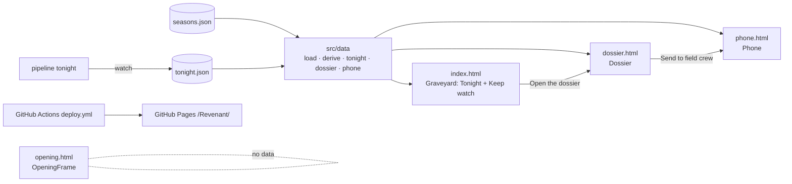

# Design Document

tonight-live

## Overview
Spec 07 finishes Revenant's surface. It has four parts:
1. **Tonight, live.** Every date on Tonight comes from the data. Stale data says so. The watch ranking is published by the pipeline. "They will wake" is built from published melt days instead of a fixed phrase.
2. **Keep watch** (puzzle 4). On Tonight, the viewer sets three lanterns on still-warm scars, seals them against the published ranking, and can save a PNG card drawn in the browser.
3. **Three new pages**, each built from published data: `dossier.html` (any replay grave), `phone.html` (field crew, 390 px) and `opening.html` (1920 × 1080 video frame).
4. **Hosting** on GitHub Pages, deployed by GitHub Actions.

It reuses the graveyard's data layer (`src/data/`), copy style, tokens and components. It adds one published field (`watch`) and no other schema change.

## Board-to-app decisions

| Board | Problem | App |
|---|---|---|
| Tab "LIVE · OCT 28"; footer "Oct 29, 2026"; "Image Oct 26 · heat and snow to Oct 28, 2026 · NASA VIIRS"; chart "TONIGHT · OCT 28"; legend "Oct 22–28" | Fixed dates from the research run | From `as_of`, `frame_date` and `points_through`. "LIVE" only when fresh (≤ 48 h) |
| "They will wake · April–May 2027 · about 160 nights" | No source | The melt spread of the published springs: middle half Apr 14–May 2 (median Apr 21), "if the snow keeps the last three springs' pace", and nights from `as_of` to the median (155 today) |
| Subline "First snow is reaching the northeast." | Editorial, no data | "{Nine} already lie under snow." (published count) |
| Gravekeeper "Thirteen of them were still warm when the first snow came. I will be watching them in April." | Research count; "when the first snow came" is not what `late_hits_14d` measures | "{Nine} of them were still warm in the last two weeks. I will be watching them in {April}" (month of the median) |
| `score = min(1, n/1202)·0.45 + min(1, late/120)·0.55` | Board-computed, research constants; the app computes it too | Published `watch` (indices, best first), same weights, normalised by the night's maxima. Today G-02, G-01, G-16 are the top three |
| "ranked by size and late heat" | Reads as a forecast | "… · a guide, not a forecast" |
| Phone: "YOU", patrol route, "NE BC PATROL", "nearest" | No location or route data | "YOU" and "NEAREST" only after the viewer shares their location, which stays on the device. No route |
| Phone: G-03 "11 days after the snow left. A late snowfall had just melted." | Research G-03; published G-03 rose 41 days after melt, with no late snow | Built from the selected grave's published row |
| Phone: Navigate / Report / Alerts / Reports | No backend; accounts and push are out of scope | Navigate is a maps link. Report uses the share sheet with a "not an official report" line. Alerts and Reports are dropped |
| Dossier: Apr 8 / Apr 19 / 11 days / 57.50°N 121.59°W / northeast BC / ~10,000 km² / late snowfall / southwest edge / ~3 km / 320 points | Research G-03 | Any grave, from its published row. Published 2024 G-03: Apr 15 melt, May 26 rise, 41 days, ≈ 59.66°N 112.27°W, northern Alberta, ≈ 1 km, 591 static cells. The late-snow band only appears where the series shows it |
| Dossier: SENSOR, FIRE POWER columns; "No crew has visited this grave yet." | Not published; no crew data | Columns dropped. "Revenant has no crew reports; crews confirm on the ground." |
| Dossier: "Export KML" of the scar | No polygon is published | KML with two points (centroid, rise), labelled as points |
| Opening: "NASA VIIRS · GIBS · REAL 2024–2026 DATA" | Omits FIRMS and NBAC | "NASA FIRMS · NASA GIBS/VIIRS · NBAC · REAL 2024–2026 DATA" |
| Parish Register footnote "Only the spring after the great fires of 2023 beats chance." | Research; already replaced in spec 03 | Unchanged (built from the `zombie` flags) |

Kept from the boards: every layout, size, colour and font, plus "They are going to sleep.", "The scars of {Y}, going under", "They will wake", "Seen from orbit", "Here lies", the phone's "At the grave, what did you see?" with Smoke / Ground heat / Nothing, "Back to the graveyard", "What the satellite saw", "Why we say it rose", "Life and afterlife", "Sightings", "Send to field crew", "Export KML", the opening's title and subtitle, and "KIROWEEN 2026 · COSTUME CONTEST".

## Hosting decision

| Option | For | Against |
|---|---|---|
| **GitHub Pages via Actions** (chosen) | The repo is already public. No new account. The future nightly workflow (spec 02 task 11) runs in the same place and redeploys by committing. Free, with no expiry | Project sites live under a sub-path (`/Revenant/`), so every URL must respect Vite `base`. One manual step: Settings → Pages → Source: GitHub Actions |
| Cloudflare Pages | Root path, fast CDN, preview links | Needs a Cloudflare account and repo connection; the nightly still runs on GitHub |
| Netlify | Root path, simple | Account; free build minutes are capped; the nightly still runs on GitHub |

The sub-path is handled once: `vite.config.ts` sets `base: '/Revenant/'` for builds. Every runtime URL goes through `asset(path)` = `import.meta.env.BASE_URL + path`. A test fails the build if any `fetch('/` or `src="/` remains in `src/`.

## Architecture

### Files
| File | Purpose |
|---|---|
| `pipeline/build.py` | `watch_order(rows)` and `watch` in `assemble_tonight` |
| `scripts/validate-data.mjs` | `watch` is a permutation of `0..g.length−1` |
| `src/data/assets.ts` | `asset(path)` under `BASE_URL` |
| `src/data/tonight.ts` | Pure: `staleness`, `meltSpread`, `wakeView`, `tonightLine`, `watchList`, `keepWatchScore`, `cardLines` |
| `src/data/dossier.ts` | Pure: `dossierView(seasons, key, id)`, `lateSnowBands(series, melt, rise)`, `kml(view)`, `parseHash` |
| `src/data/phone.ts` | Pure: `haversineKm`, `nearest`, `phoneView`, `shareText`, `mapsLink` |
| `src/copy/tonight.ts`, `src/copy/dossier.ts`, `src/copy/phone.ts` | Every new line |
| `src/components/KeepWatch.tsx` | The Keep watch panel and its clue card |
| `src/components/EpitaphCard.ts` | `drawEpitaphCard(canvas, lines)`: canvas 1200 × 630, waits for `document.fonts.ready`, returns a Blob |
| `src/scenes/Dossier.tsx`, `src/scenes/Phone.tsx`, `src/scenes/OpeningFrame.tsx` | The three boards |
| `src/entries/dossier.tsx`, `phone.tsx`, `opening.tsx`; `dossier.html`, `phone.html`, `opening.html` | Vite multi-page entries |
| `.github/workflows/deploy.yml` | Build, gate and deploy to Pages on push to `main` |
| Changes | `types.ts`/`load.ts`: `watch`. `derive.ts`: `cardList` and the `score` from `watch`; dates from the file. `copy/graveyard.ts`: Tonight strings. `useGraveyard`: the `keep` state. `Graveyard.tsx`: footer, stale line, Keep watch. `Exhumation.tsx`: "Open the dossier". `vite.config.ts`: `base`, `rollupOptions.input` |

## State
- `keep: { marks: string[]; sealed: boolean } | null` in `useGraveyard`.
  - It is set to `{ marks: [], sealed: false }` on entering Tonight, and cleared on leaving.
  - `keepMark(id)` toggles a lantern on a still-warm scar, up to `min(3, warm)`. It does nothing on a cold scar, and nothing once sealed.
  - `keepSeal` requires `min(3, warm)` marks. `keepAgain` clears the marks.
- On Tonight, a stone's button sets a lantern while Keep watch is open and unsealed. Otherwise it opens the exhumation, as today.
- The Gravekeeper's Tonight line and the stale line are spoken on entering Tonight, using the existing `say` action.
- The dossier and phone pages each have a small local state: grave, season, location (phone only) and observation (phone only). They read `location.hash` once on load and on `hashchange`.

## Pure logic (highlights)
- **`watch_order(rows)`** (Python): `score_i = 0.45·size_i/max(size) + 0.55·(late_i/max(late) if max(late) > 0 else 0)`. Indices are sorted by (−score, −size, index).
- **`staleness(asOf, now)`**: `{ stale: now − asOf > 48 h, days: floor((now − asOf)/24 h) }`.
- **`meltSpread(seasons)`**: all published melt days ≥ 0, sorted. q1, median and q3 by index `floor((n−1)·p)`. Returns `null` when n < 4. Dates are mapped onto Mar 21 of Y+1, where Y comes from Tonight's `points_through`.
- **`keepWatchScore(marks, watch, ids)`**: `k = |marks ∩ top3(watch)|` and `top3 = ids of watch[0..2]`.
- **`cardLines(view)`**: the strings the canvas draws. It is pure and tested, so the PNG holds only what the lines say.
- **`dossierView`** is built from the same helpers as `exhumation()` in `derive.ts` (epitaph, checks, crops, curve), plus `lateSnowBands`. These are runs of days d with melt < d < (rise ?? melt + 50) and series[d] ≥ 15.
- **`haversineKm(lat1, lon1, lat2, lon2)`** with R = 6371 km. `nearest(pos, graves)` is the argmin, with ties broken by lower index.
- **`kml(view)`**: KML 2.2 with two `<Placemark>`s, centroid and rise. Coordinates are lon,lat from the grid formulas, to 4 decimals.

## Correctness Properties
- **Property 1: the ranking is published, complete and ordered.** For any Tonight rows, `watch_order` is a permutation of the indices. Its scores do not increase along the order, and ties keep (−size, index). The validator rejects a non-permutation. **Validates: Requirement 2.1, 2.2**
- **Property 2: staleness is exact.** `stale` iff now − asOf > 48 h. `days` = floor of the elapsed whole days. "LIVE" appears iff not stale. **Validates: Requirement 1.3**
- **Property 3: the wake window is published melt days.** q1 ≤ median ≤ q3, each equal to some published melt day. The dates are those days from Mar 21 of Y+1. Graves with melt −1 are ignored. Fewer than 4 gives `null`. **Validates: Requirement 3.1, 3.2**
- **Property 4: Keep watch counts only what it should.** Marks are only still-warm ids, at most `min(3, warm)`. k is in 0..3 and equals the overlap with the top three of `watch`. Every sealed line contains "crews confirm" and never "will return". **Validates: Requirement 4.2, 4.4**
- **Property 5: dossier and phone text carries only published numbers.** Every number in `dossierView`, `phoneView` and `cardLines` text is a published field, or a documented derivation of one (km² from size, lat/lon from the grid, day counts, dates, percent, the melt spread). **Validates: Requirements 4.5, 5.2–5.7, 6.2, 6.4**
- **Property 6: late-snow bands are real.** Every band day d satisfies melt < d < end and series[d] ≥ 15. No band appears when no such day exists. **Validates: Requirement 5.5**
- **Property 7: nearest is nearest.** For any position and graves, `nearest` has the minimum `haversineKm`. haversine is symmetric and 0 at the same point. **Validates: Requirement 6.4**
- **Property 8: KML matches the grid.** Two placemarks, whose coordinates invert to the grave's grid points within 0.5 px. **Validates: Requirement 5.8**
- **Property 9: URLs respect the base.** No source file fetches or links a root-absolute `/…` path. The production bundle of `index.html` reads no query parameters or hash. **Validates: Requirements 8.2, 8.3**

## Testing
- **pytest + Hypothesis:** `watch_order` (Property 1). `assemble_tonight` includes `watch`.
- **node --test:** the validator accepts the new file and rejects a duplicate or missing index.
- **Vitest + fast-check:** `src/data/tonight.test.ts`, `dossier.test.ts`, `phone.test.ts` (Properties 2–8). A source scan for Property 9.
- **@testing-library/react:**
  - Tonight footer dates and stale text, with a fixed clock.
  - Keep watch: marks only warm, seal compares, card lines.
  - The dossier for 2024 G-03, checking the published values (Apr 15, May 26, 41 days).
  - Phone without location, then with a mocked position.
- **Playwright checkpoints** as in Requirement 9.3, on `npm run dev`, then once on the deployed site.

## Out of scope
Real patrol routes, report storage or submission, accounts, push notifications, lightning, and multi-region. The nightly data workflow is spec 02 task 11.
