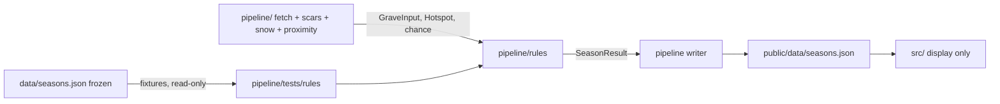

# Design Document — zombie-rule-engine

## Overview

`pipeline/rules/` is a small, pure Python 3.12 package with no third-party runtime dependencies. It turns per-grave snow
series and hotspots into melt day, rise, daily state and a season summary. The pipeline (spec 02) is its only caller and
publishes the results to `public/data/*.json`; the UI (specs 03–07) reads those results and does not re-implement any rule.

Tests use pytest plus Hypothesis (property-based) and fixtures built from the frozen research data `data/seasons.json`.

## Requirements analysis

Ambiguities found in the prompt and sources, and how this design settles them:

| Question | Sources | Decision | Why |
|---|---|---|---|
| Must the melt start day itself be valid? | `docs/method.md` says "first **valid** day starting a 7-day window"; the comment in `reference/gibs-pipeline.js` L51 says "first day d with ≥3 valid obs in [d, d+6]" | Start day must be valid **and** snow-free | Checked against `data/seasons.json`: requiring a valid start reproduces 70/72 stored melt days; dropping it reproduces only 65/72 (seven 2026 graves move from 41 to 38). |
| Windows near the end of the series | Not stated | Cut the window at the last day; still need ≥ 3 valid days | Both readings give the same 70/72 on the research data; cutting is the reading that needs no extra constant. |
| Is the 50-day window inclusive? | Prompt: `[melt, melt+50]`; board `Main.dc.html` L887 rests when `d − melt > 50` | Inclusive both ends; LaidToRest from melt+51 | Same in both sources. |
| Rise location when several hits share the rise day | `reference/gibs-pipeline.js` L52: "location = mean of that day's hits" | Mean of that day's `on_scar` hits | Matches the baseline and is independent of input order. |
| Rise on the melt day itself | Not stated | Allowed; state goes Buried → Risen with no Waking day | Window is inclusive at melt. |
| Window still open when data ends | Not stated | Grave stays Waking; not LaidToRest | Saying "laid to rest" would claim days we have no data for (honesty.md). |
| Fraction or percent | `method.md` says fraction; `seasons.json` stores whole percent with −1 = missing | Engine takes fractions in [0, 1] and `None`; the fixture loader converts | One unit inside the Engine; conversion stays at the boundary. |
| Zombie-year denominator | `method.md`: `risen / 24`; board L722 `N / 24` | `risen / len(graves)` | Equal to 24 for all published seasons; avoids a hidden constant if a season has fewer scars. |
| Where proximity is decided | Prompt: hotspot has `onScar` | Upstream (pipeline) | Imagery ~3 px vs FIRMS 1 km is a data-source concern, not a rule. |
| Chance baseline | Prompt: passthrough | Validated, passed through unchanged | Computed by the pipeline's offset simulation. |
| Early hits | `seasons.json` stores a count, not dates | Engine reports a count; fixtures don't fabricate dates for them | Inventing hotspot days would break honesty.md. Covered by properties instead. |

## Architecture



## Components and Interfaces

### Module layout

```
pyproject.toml               # project + uv config, pytest/hypothesis dev group, pytest pythonpath="."
pipeline/__init__.py
pipeline/rules/__init__.py   # re-exports the public API below
pipeline/rules/constants.py  # SNOW_FREE_BELOW=0.15, MELT_WINDOW_DAYS=7, MIN_VALID_OBS=3, RISE_WINDOW_DAYS=50, ZOMBIE_FACTOR=1.4
pipeline/rules/types.py      # dataclasses + State enum
pipeline/rules/validate.py   # input checks (Requirement 1)
pipeline/rules/melt.py       # melt_day()
pipeline/rules/risen.py      # find_rise(), early_hits()
pipeline/rules/states.py     # state_on(), timeline()
pipeline/rules/season.py     # classify_grave(), classify_season(), is_zombie_year()
pipeline/tests/rules/
  conftest.py                # Hypothesis profiles; fixture loader for data/seasons.json
  strategies.py              # Hypothesis strategies for series, hotspots, graves
  test_melt.py  test_risen.py  test_states.py  test_season.py  test_validate.py
  test_properties.py         # Correctness Properties 1–14
  test_research_fixtures.py  # Requirement 6
  test_purity.py             # Requirement 1.9 (AST import scan)
```

### Function signatures

```python
def melt_day(snow: Sequence[float | None]) -> int | None
def find_rise(hotspots: Iterable[Hotspot], melt: int | None, season_length: int) -> Rise | None
def early_hits(hotspots: Iterable[Hotspot], melt: int | None) -> int
def state_on(day: int, melt: int | None, rise: Rise | None) -> State
def classify_grave(g: GraveInput, season_length: int) -> GraveResult
def classify_season(graves: Sequence[GraveInput], chance: float, season_length: int) -> SeasonResult
def is_zombie_year(risen: int, graves: int, chance: float) -> bool
```

All functions are total over validated input and deterministic. Tuples and frozen dataclasses keep results immutable.

### Algorithms

**melt_day** — for d in 0…n−1: skip unless `snow[d]` is not None and < 0.15; take `w = [v for v in snow[d:d+7] if v is not None]`;
return d if `len(w) >= 3 and all(v < 0.15 for v in w)`. Return None after the loop. O(7n).

**find_rise** — if melt is None return None. `hi = min(melt + 50, n − 1)`. Keep `on_scar` hotspots with melt ≤ day ≤ hi. If none,
None. Else rise day = min day; location = mean x, mean y of hits on that day (`math.fsum` for order independence).

**early_hits** — count of `on_scar` hotspots with day < melt (0 if melt is None).

**state_on** — Buried if melt is None or day < melt; Risen if rise and day ≥ rise.day; LaidToRest if day − melt > 50; else Waking.

**is_zombie_year** — `graves > 0` required; `risen / graves > ZOMBIE_FACTOR * chance`.

## Data Models

```python
class State(str, Enum):
    BURIED = "buried"; WAKING = "waking"; RISEN = "risen"; LAID_TO_REST = "rest"   # values match the board's st codes

@dataclass(frozen=True)
class Hotspot:  day: int; x: float; y: float; on_scar: bool

@dataclass(frozen=True)
class GraveInput:
    id: str; size: int; cx: float; cy: float
    snow: tuple[float | None, ...]
    hotspots: tuple[Hotspot, ...] = ()

@dataclass(frozen=True)
class Rise:  day: int; x: float; y: float

@dataclass(frozen=True)
class GraveResult:
    id: str
    melt_day: int | None
    rise: Rise | None
    early_hits: int
    states: tuple[State, ...]              # len == season length
    days_since_melt: tuple[int | None, ...]

@dataclass(frozen=True)
class SeasonResult:
    graves: tuple[GraveResult, ...]
    risen_count: int
    chance: float
    zombie_year: bool
    season_length: int
```

### Fixture mapping from `data/seasons.json`

Grave row `[size_px, cx, cy, melt_day, rise|0, early_hits, "snow% series"]`, `rise = [day, x, y]`:

- `id = f"G-{i+1:02d}"`, size/cx/cy as stored.
- `snow = tuple(None if v == -1 else v / 100 for v in series.split(","))`; season length = 103.
- `hotspots = (Hotspot(day, x, y, on_scar=True),)` if rise else `()`. Early hits are not turned into hotspots (no dates stored).
- Chance per season comes from `docs/method.md` (0.347, 0.365, 0.201) because `data/seasons.json` has no `chance` field.
- Expected: risen 15 / 8 / 4; stored melt matches except `(2024, G-16): 21→22` and `(2025, G-10): 54→59`; zombie flags T / F / F.

## Correctness Properties

Each property is a Hypothesis test in `pipeline/tests/rules/test_properties.py`, at least 200 examples (`ci` profile: 1000).
Strategies generate season lengths 1–120, snow series mixing `None`, values near the 0.15 boundary (0.149, 0.15, 0.151) and
the full [0, 1] range, and hotspots on and off scar across the whole season.

### Property 1: States are monotonic
*For any* valid grave, the state sequence SHALL never move backwards in the order Buried < Waking < {Risen, LaidToRest}, and SHALL contain at most one of Risen and LaidToRest.
**Validates: Requirements 4.1, 4.2, 4.3, 4.4**

### Property 2: Never rises before melt
*For any* valid grave with a rise, rise day ≥ melt day, and every day before the melt day is Buried.
**Validates: Requirements 3.3, 4.1**

### Property 3: Risen implies a hotspot in the window
*For any* valid grave with a rise, at least one input hotspot has `on_scar` true and day == rise day, and melt ≤ rise day ≤ min(melt + 50, n − 1).
**Validates: Requirements 3.1, 3.4**

### Property 4: No hotspots, no risings
*For any* valid season, removing all hotspots (or setting every `on_scar` false) yields risen count 0 and no Risen state on any day, while melt days are unchanged.
**Validates: Requirements 3.5, 5.1**

### Property 5: Time shift
*For any* valid grave and k ≥ 0, prepending k missing days to the snow series and adding k to every hotspot day shifts the melt day and rise day by exactly k (None stays None) and leaves the rise location unchanged.
**Validates: Requirements 2.1, 2.5, 3.1**

### Property 6: Melt day is the first qualifying day
*For any* snow series with melt day m, m satisfies Requirement 2.1 and no earlier day does; with melt None, no day does. (Checked against an independent brute-force oracle written differently from `melt_day`.)
**Validates: Requirements 2.1, 2.2, 2.3, 2.4**

### Property 7: Threshold is strict
*For any* snow series, replacing every valid value with 0.15 yields melt None; replacing every value with 0.0 yields melt 0 when n ≥ 3, and None when n < 3.
**Validates: Requirements 2.3, 2.4**

### Property 8: Missing data never creates a melt
*For any* snow series with melt None, turning any snow-free valid day to missing, or any missing day to a snow value (≥ 0.15), keeps melt None. (Turning a *snowy* day to missing can legitimately create a melt, e.g. `0.1, 0.1, 0.1, 0.5` → `0.1, 0.1, 0.1, None`, so that case is excluded.)
**Validates: Requirements 2.5**

### Property 9: Hotspot order does not matter
*For any* valid grave, any permutation of its hotspots gives an identical GraveResult.
**Validates: Requirements 3.7**

### Property 10: Out-of-window and off-scar hotspots are inert
*For any* valid grave, adding hotspots dated before melt, after melt + 50, or with `on_scar` false leaves rise unchanged; pre-melt on-scar additions raise early_hits by exactly their count.
**Validates: Requirements 3.3, 3.4, 3.5, 3.8**

### Property 11: Laid to rest only after the window closes
*For any* valid grave without a rise, LaidToRest appears on day d iff melt is not None and d > melt + 50; when melt + 50 ≥ n − 1 the last state is Waking.
**Validates: Requirements 4.3, 4.6**

### Property 12: Season summary agrees with graves
*For any* valid season, risen_count equals the number of graves with a rise, chance is returned unchanged, zombie_year equals `risen/len > 1.4 × chance`, and grave order and ids match the input.
**Validates: Requirements 5.1, 5.2, 5.3, 5.5**

### Property 13: Zombie flag is monotone in risings and chance
*For any* graves count g > 0 and chance c, if `is_zombie_year(r, g, c)` then `is_zombie_year(r + 1, g, c)` (r + 1 ≤ g) and `is_zombie_year(r, g, c′)` for c′ ≤ c.
**Validates: Requirements 5.3**

### Property 14: Inputs are not mutated, results are deterministic
*For any* valid season, calling `classify_season` twice gives equal results and the inputs compare equal to deep copies taken before the call; days_since_melt is `d − melt` from melt on and None before.
**Validates: Requirements 1.9, 4.5, 4.7**

## Error handling

`validate.py` runs once at the top of `classify_season` / `classify_grave` and raises `ValueError` with the grave id and day
(Requirements 1.4–1.8, 1.10–1.13, 5.4). Type checks run before range checks, so a value parsed wrongly from CSV
(e.g. day `"12"` or `12.0`, a NaN coordinate) fails loudly at the boundary instead of reaching published JSON, where `NaN`
is not valid. `bool` is rejected wherever a number is expected, because Python treats it as an `int`.
The rule functions assume validated input and do not catch exceptions. Clouds and swath gaps
reach the Engine as `None`; they are handled by Requirement 2.5, never as zero snow.

## Testing strategy

- **Example tests** per module: hand-built series for each boundary (exactly 0.15, 2 vs 3 valid days, window cut at series end,
  rise on melt day, rise at melt+50 vs melt+51, never-melting grave, melt+50 past the series end).
- **Property tests**: Properties 1–14 above; Hypothesis `dev` profile (200 examples) and `ci` profile (1000), chosen by `HYPOTHESIS_PROFILE`.
- **Research fixtures**: Requirement 6, from `data/seasons.json`, read-only.
- **Purity**: AST scan of `pipeline/rules/*.py` fails on imports of `os`, `io`, `pathlib`, `json`, `socket`, `requests`, `urllib`, `time`, `datetime`, `random`.
- Command: `uv run --python 3.12 pytest -q pipeline` (AGENTS.md). The `pipeline-tests` hook runs it on save once enabled.
