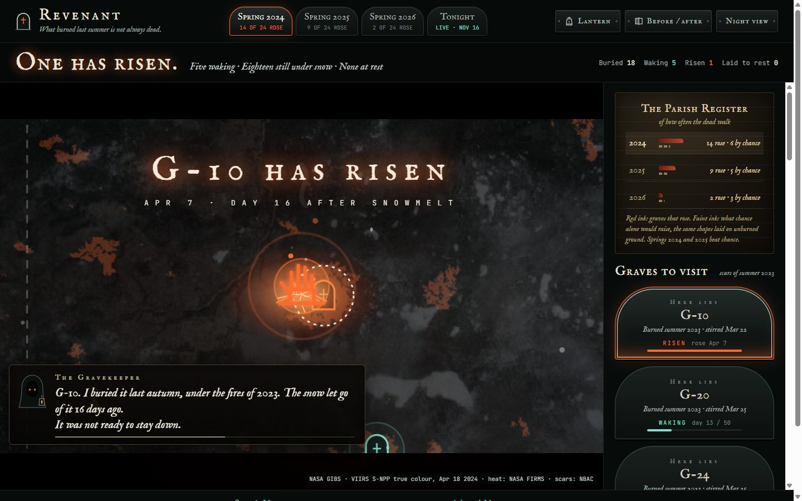
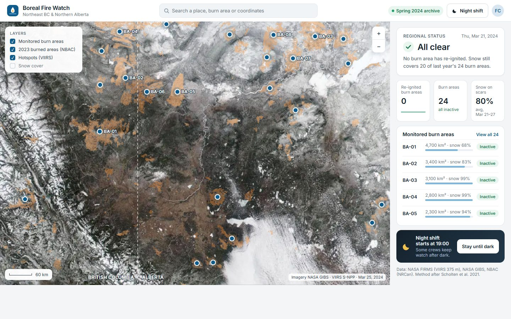
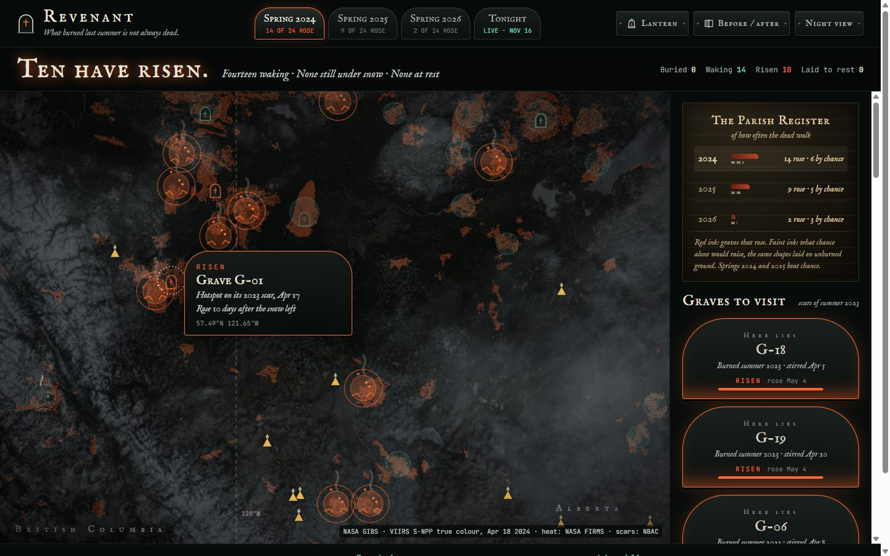
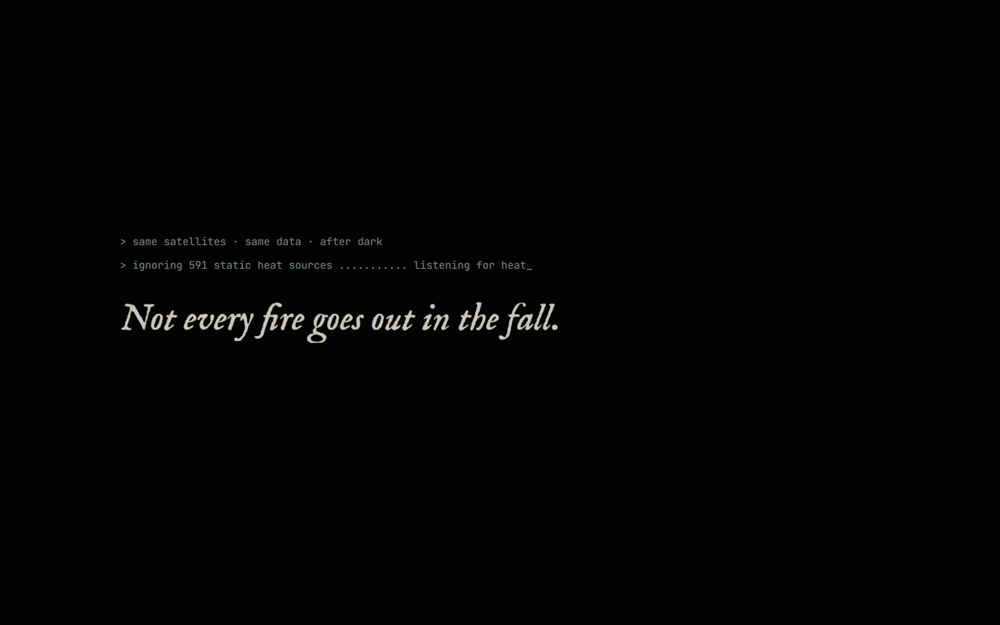
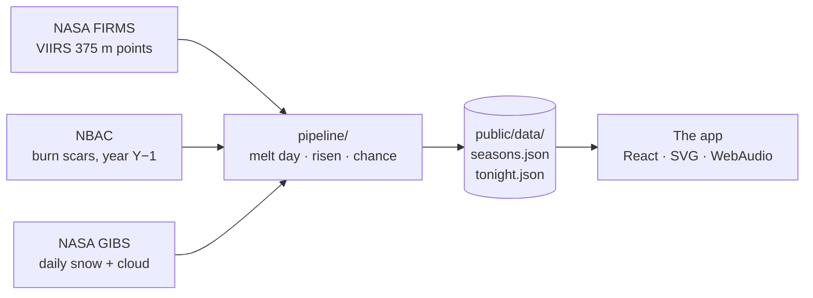
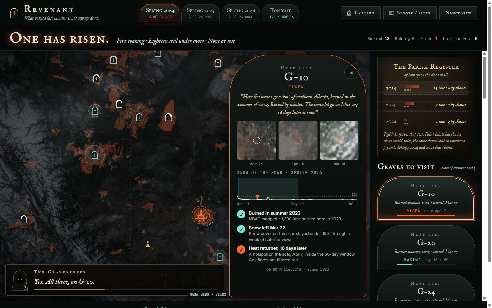
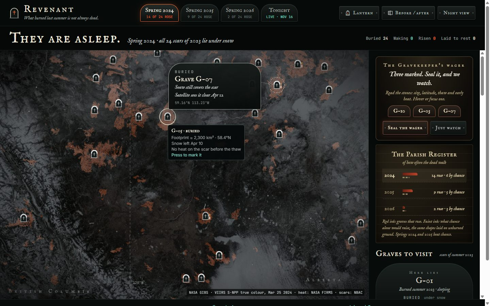
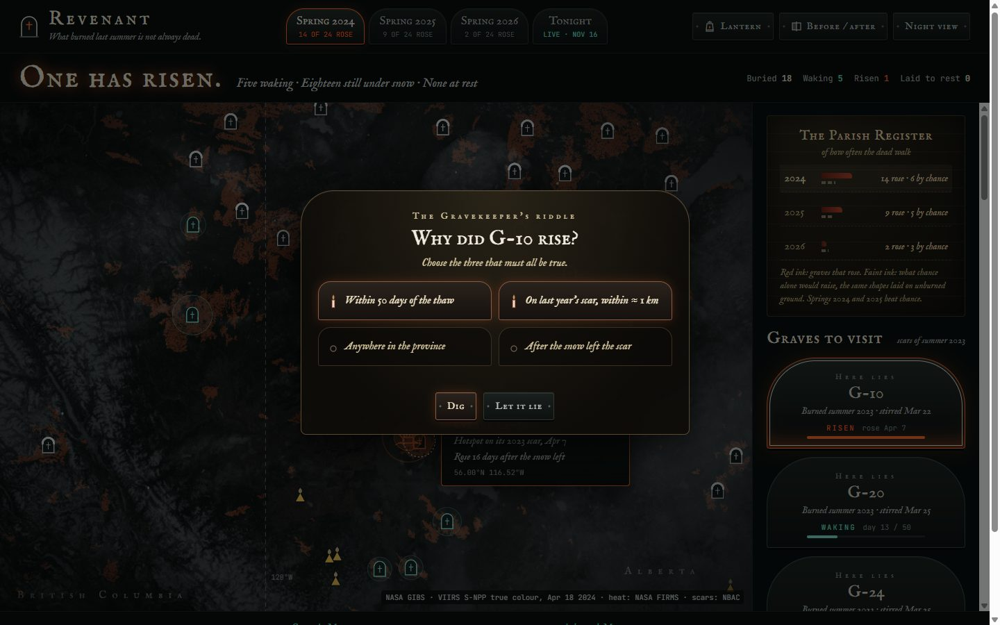

<p align="center">
  
</p>

<h1 align="center">Revenant</h1>

<p align="center">
  <em>What burned last summer is not always dead.</em>
</p>

<p align="center">
  <a href="https://kiroween.devpost.com/"></a>
  <a href="https://kiro.dev"></a>
</p>

<p align="center">
  
  
  
  
  
  <a href="LICENSE"></a>
</p>

<p align="center">
  <a href="#the-rule">The rule</a> ·
  <a href="#what-the-data-says">Results</a> ·
  <a href="#inside-the-graveyard">The graveyard</a> ·
  <a href="#puzzles">Puzzles</a> ·
  <a href="#quick-start">Quick start</a> ·
  <a href="#how-it-was-built">How it was built</a> ·
  <a href="#honest-caveats">Caveats</a> ·
  <a href="#data-and-credits">Credits</a>
</p>

<p align="center">
  
</p>

Some wildfires don't go out in the fall. They smoulder all winter in peat and deep soil under the snow, then flare up again in spring on last year's burn scar, often weeks before the normal fire season. Fire crews call them holdover or overwintering fires. Everyone else calls them **zombie fires**.

**Revenant** is an early-warning map for them across northeast British Columbia and northern Alberta, built on NASA satellite data. It's dressed as a graveyard: every burn scar is a grave, and every spooky thing on screen is a data rule.

> [!NOTE]
> Revenant is an entry in the [Kiroween 2026](https://kiroween.devpost.com/) Costume Contest, and it's still being built. See [Status](#status) for what works today.

## Two realities

The app opens as a plain fire-agency viewer. Press **Night shift** and the colour drains away. The same 24 burn areas come back as tombstones.

<table>
  <tr>
    <td width="50%"></td>
    <td width="50%"></td>
  </tr>
  <tr>
    <td align="center"><b>Daylight: Boreal Fire Watch</b><br><sub>Spring 2024 archive. "All clear." Snow still covers 20 of last year's 24 burn areas.</sub></td>
    <td align="center"><b>Night: the graveyard</b><br><sub>The same scars 46 days on: ten have risen, fourteen are waking.</sub></td>
  </tr>
</table>

<p align="center">
  
</p>

## The rule

> A spring hotspot is a **revenant** if it lies within **≈ 1 km** of last year's burn scar, and appears **after** the snow leaves that scar and **within 50 days** of it. Static heat sources such as gas flares don't count.

This is the detection idea from [Scholten et al., *Nature* 2021](https://www.nature.com/articles/s41586-021-03437-y). The rule is written once, in Python ([`pipeline/rules/`](pipeline/rules)), and property-tested. The app only shows what the pipeline publishes; it never re-decides a grave.



- **Melt day:** the first day of a 7-day window with at least 3 clear views, all under 15 % snow on the scar.
- **Risen:** the first hotspot within ≈ 1 km of the scar between the melt day and 50 days after it.
- **Chance baseline:** every scar shape is moved to random unburned ground, up to 30 times, and the same test runs there. That hit rate is what chance alone would give.
- **Zombie year:** more graves rose than 1.4 × chance.

The full method, with every threshold and source, is in [docs/method.md](docs/method.md).

## What the data says

The 24 largest scars of each fire year, tested the following spring:

| Spring | Scars from | Rose | Chance | Bar (1.4 × chance) | Verdict |
|---|---|---|---|---|---|
| 2024 | NBAC 2023 | **14 / 24** (58 %) | 26.3 % | 36.9 % | 🔥 Zombie year |
| 2025 | NBAC 2024 | **9 / 24** (38 %) | 21.5 % | 30.1 % | 🔥 Zombie year, by a thin margin |
| 2026 | NBAC 2025 | 2 / 24 (8 %) | 12.1 % | 16.9 % | 🕯️ Quiet |

Generated 2026-11-17 from FIRMS points and NBAC polygons. 591 static heat cells were removed.

The 2025 result depends on how cloud is handled: with 7 risings instead of 9 it would fall under the bar. Spring 2026 shows nothing, and the Gravekeeper says so: *"I do not cry wolf."*

## Inside the graveyard

Every symbol on the map is a rule, and the legend says which.

| You see | It means |
|---|---|
| ❄️ A snow cap on the stone | **Buried:** snow still covers the scar |
| 🟢 A teal halo, breathing | **Waking:** the snow has gone and the 50-day window is open |
| 🔥 A burning hand and embers | **Risen:** a hotspot on the scar inside the window |
| 🪦 A stone sunk and faded | **Laid to rest:** the window closed with no heat |
| 🕯️ A yellow candle | **New fire:** more than about 15 km from every scar, so not a revenant |
| 🩸 A red drip on the candle timeline | A rising on that day |
| 📜 Red ink against faint ink in the Parish Register | Graves that rose against what chance would raise |

The replay runs by itself and waits whenever you stop to look. When a grave rises, the camera pushes in 2.4×, the screen letterboxes, the ground splits and a bell tolls. The **Gravekeeper** narrates the season from real dates and counts. Click any stone to **exhume** it: its epitaph comes from its data, with three satellite crops, its snow curve and the rule checked line by line.

<table>
  <tr>
    <td width="50%"></td>
    <td width="50%"></td>
  </tr>
  <tr>
    <td align="center"><b>Exhumation</b><br><sub>An epitaph from the data: "Here lies some 1,300 km² of northern Alberta…"</sub></td>
    <td align="center"><b>The wager</b><br><sub>Mark three graves before the replay. The clues are published values only.</sub></td>
  </tr>
</table>

Turn your sound on. The wind, drone, bell, boom and creak are all made live with WebAudio; there are no audio files.

## Puzzles

Five puzzles teach the rule by playing it.

| | Puzzle | What you do | Status |
|---|---|---|---|
| 1 | **Read the stones** | Bet on three graves using size, latitude, thaw date and early heat. Each hit makes your lantern burn brighter. | ✅ Built |
| 2 | **The Gravekeeper's riddle** | After the first rising, pick the three conditions that made it a revenant, and avoid the decoy. | ✅ Built |
| 3 | **Lantern hunt** | Search the dark for new fires that aren't revenants. | 🚧 Next |
| 4 | **Keep watch** | On Tonight, set three lanterns on this autumn's still-warm scars as your watch list for spring 2027. | 📋 Planned |
| 5 | **Is it chance?** | Drag a grave's own shape onto unburned ground and see whether that spot caught heat, using the chance test's real offsets. | 📋 Planned |

<p align="center">
  
</p>

## Quick start

You need [Node.js](https://nodejs.org/) 20.19+ or 22.12+.

```bash
npm install
npm run dev      # http://localhost:5173
```

The app opens in daylight; press **Night shift**. On the dev server only, `?intro=0` skips to the graveyard, and `?season=s2025&day=40` opens a season on a given day.

| Command | What it does |
|---|---|
| `npm test` | Vitest and fast-check tests for the UI |
| `npm run check` | ESLint, then the TypeScript check |
| `npm run build` | Production build into `dist/` |

### The data pipeline

The published data is already in `public/data/`. To rebuild it you need Python 3.12, [uv](https://docs.astral.sh/uv/) and a free [NASA FIRMS map key](https://firms.modaps.eosdis.nasa.gov/api/map_key/) in `FIRMS_MAP_KEY`.

```bash
uv run --python 3.12 pytest -q pipeline           # rule and pipeline tests
uv run --python 3.12 python -m pipeline seasons   # rebuild seasons.json and the scar masks
uv run --python 3.12 python -m pipeline tonight   # rebuild tonight.json and the latest frame
```

Each file is checked by [`scripts/validate-data.mjs`](scripts/validate-data.mjs) before it replaces the published one.

## How it was built

Revenant was built in [Kiro](https://kiro.dev) one spec at a time, and everything Kiro used is in [`.kiro/`](.kiro).

- **Specs** ([`.kiro/specs/`](.kiro/specs)): requirements, design and tasks for each part: rule engine, data pipeline, graveyard map, daylight and nightfall, rising and sound, Gravekeeper and wager.
- **Steering** ([`.kiro/steering/`](.kiro/steering)): the honesty rules, the costume rules, the Gravekeeper's voice, the pipeline method and the tech stack.
- **Hooks** ([`.kiro/hooks/`](.kiro/hooks)): pipeline tests, a data contract check, an honesty review of copy, UI checks and a task gate.
- **Skills and agents:** design-board reading and porting, FIRMS and GIBS fetchers, and a `gravekeeper` agent that writes only copy.
- **Property-based tests:** Hypothesis for the Python rule engine and fast-check for the UI. To check that the properties weren't vacuous, rule bugs were planted on purpose; the tests caught 13 of 14.
- **Visual checks:** every screen was screenshotted with Playwright and compared with the design boards in [`reference/design/`](reference/design).

The build log is in [docs/KIRO_LOG.md](docs/KIRO_LOG.md).

<details>
<summary><b>Project layout</b></summary>

| Path | Contents |
|---|---|
| `src/data/` | Loaders, types and pure derivations of the published data |
| `src/scenes/` | Daylight, nightfall and the graveyard |
| `src/components/` | Tombstones, Gravekeeper, wager, riddle, exhumation, register, candle timeline |
| `src/audio/` | Wind, drone, bell, boom and creak in WebAudio |
| `src/copy/` | Every line on screen, including the Gravekeeper's |
| `pipeline/` | FIRMS, GIBS and NBAC fetch, and the rule engine in `pipeline/rules/` |
| `public/data/`, `public/img/` | Published data, VIIRS keyframes and scar masks |
| `data/` | The frozen research baseline, from rendered imagery |
| `reference/design/` | The design boards: the visual source of truth |
| `docs/` | Brief, method, design reference and the Kiro log |

</details>

## Status

- [x] Rule engine, with property tests
- [x] Data pipeline: FIRMS points, NBAC scars, cloud-masked snow, chance baseline
- [x] Graveyard map, Parish Register, candle timeline, exhumation, lantern, before/after
- [x] Daylight viewer and the nightfall reveal
- [x] The rising cinematic and sound
- [x] The Gravekeeper's narration, the wager and the riddle
- [ ] Lantern hunt, the verdict and quiet-year whispers
- [ ] Tonight (live), the field-crew phone view and the grave dossier
- [ ] Nightly data refresh with GitHub Actions

## Honest caveats

The costume is spooky; the data is not.

- **"On the scar" means ≈ 1 km.** It's measured in EPSG:3978, which shrinks distances here by 1.6–2.8 %.
- **Cloud is missing data,** not "no snow" and not "no fire". Even with the cloud mask, the median grave is missing 38–54 of its 103 snow days.
- **2025 is close.** The verdict depends on the cloud method and has a margin of two graves.
- **Small sample:** one region, three springs, and a simple offset test for chance.
- **Late-autumn heat** can be slash-pile burning, so Tonight always says *crews confirm*. It never says a fire will return.

## Data and credits

- [NASA FIRMS](https://firms.modaps.eosdis.nasa.gov/): VIIRS 375 m active fire points from S-NPP, NOAA-20 and NOAA-21.
- [NASA GIBS](https://www.earthdata.nasa.gov/engage/open-data-services-software/earthdata-developer-portal/gibs-api) / VIIRS: true colour, NDSI snow cover and cloud top height.
- [NBAC](https://cwfis.cfs.nrcan.gc.ca/datamart/metadata/nbac), the National Burned Area Composite (Natural Resources Canada, CWFIS): burn scars for 2023–2025, release 20260513.
- Scholten, R. C. et al. (2021). [Overwintering fires in boreal forests](https://www.nature.com/articles/s41586-021-03437-y). *Nature*.
- Jain, P. et al. (2024). [Drivers and impacts of the record-breaking 2023 wildfire season in Canada](https://www.nature.com/articles/s41467-024-51154-7). *Nature Communications* 15, 6764. Cited for the 2023 record in the Gravekeeper's lines.

> We acknowledge the use of imagery provided by services from NASA's Global Imagery Browse Services (GIBS), part of NASA's Earth Science Data and Information System (ESDIS).

Revenant is not an official warning service. For real fire information, follow [BC Wildfire Service](https://www2.gov.bc.ca/gov/content/safety/wildfire-status) and [Alberta Wildfire](https://www.alberta.ca/wildfire-status).

## Licence

[MIT](LICENSE) © 2026 Reuben-Alex
